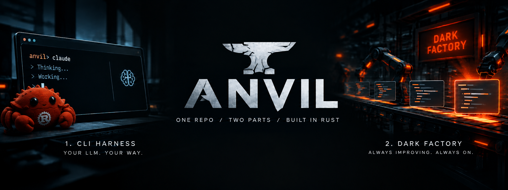
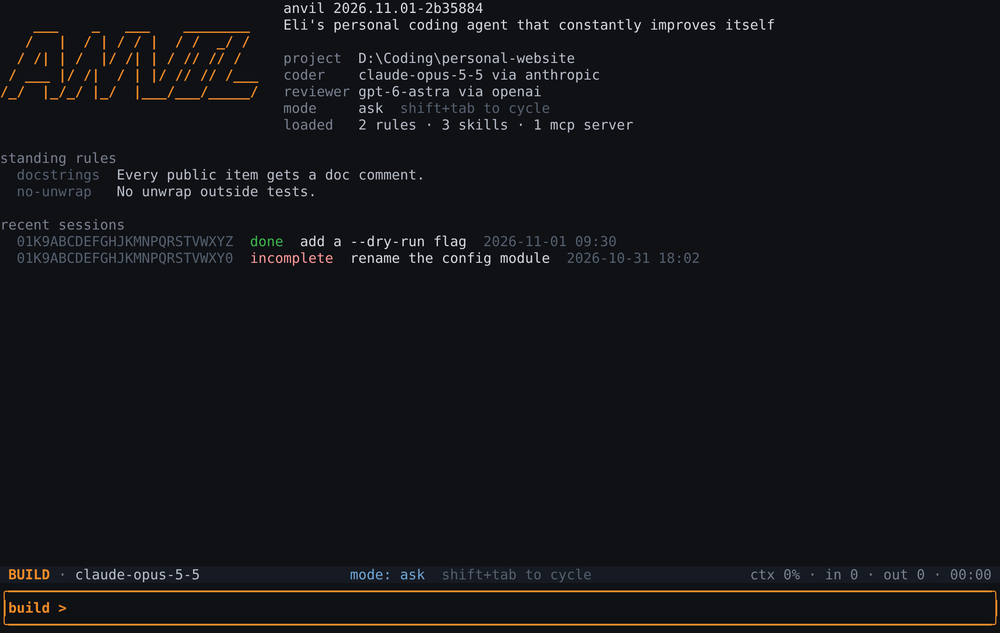
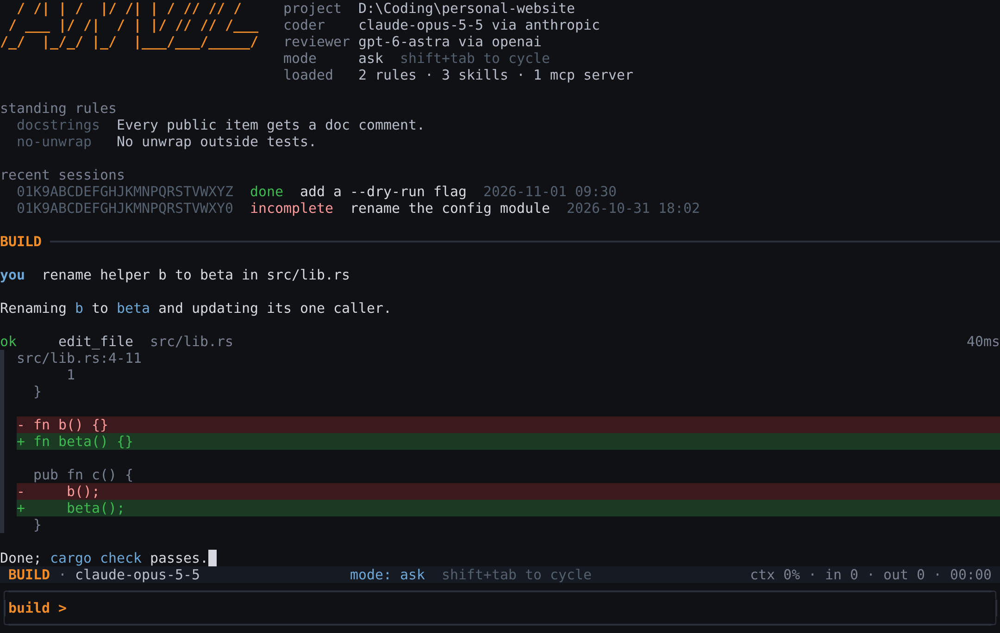
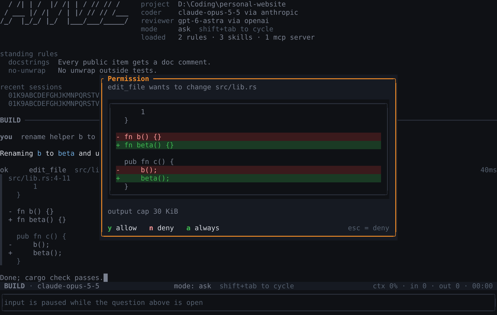
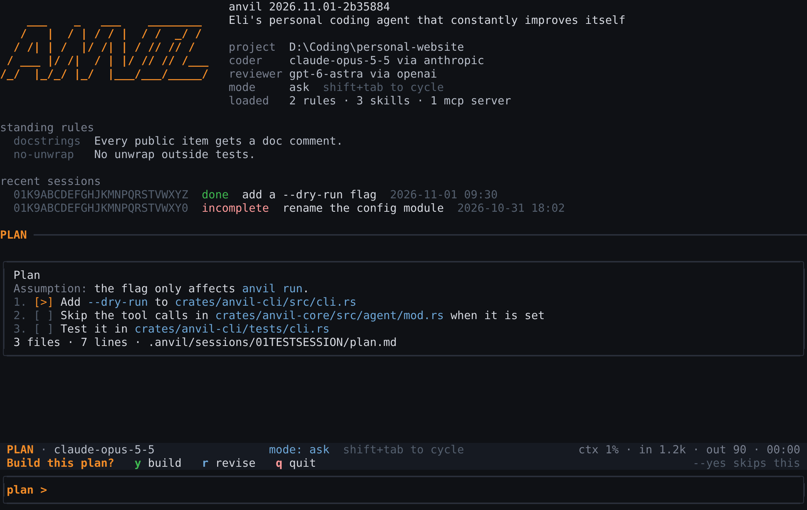
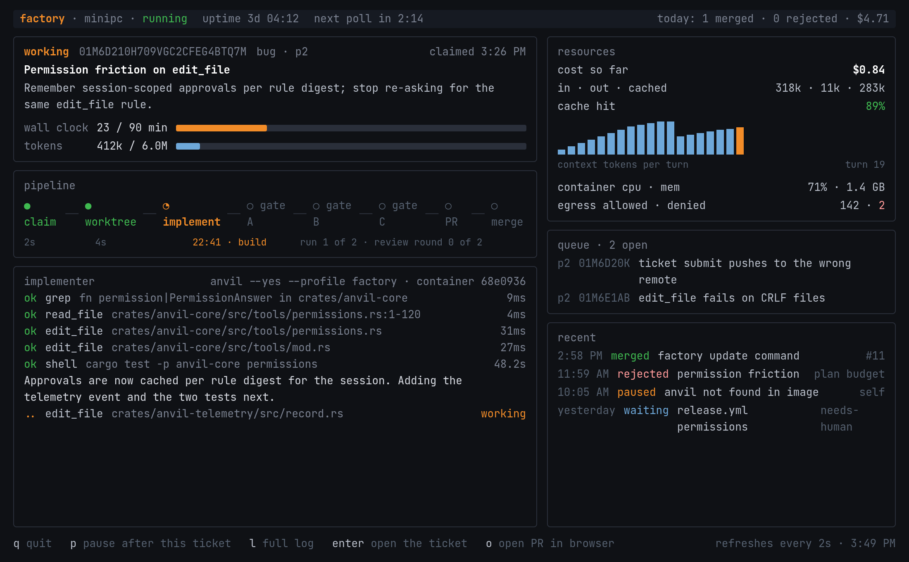
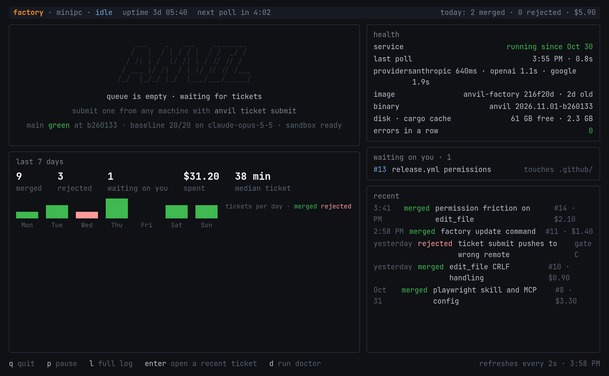

# Anvil

<p align="center">
  
</p>

Anvil is a coding agent you run from the terminal, plus an unattended service that keeps improving it. Both are Rust binaries in this workspace, they share one types crate, and they talk to each other through a file-based ticket queue with git history. Models are configuration, not code: any OpenAI- or Anthropic-protocol endpoint can play any role.

## What it is

**`anvil`, the CLI harness.** A coding agent for your own projects. Point it at a repository, give it a task, and it plans, builds, reviews and verifies the change with a real tool set (shell, files, search) under a permission model you control. It reads Claude Code's conventions (`CLAUDE.md`, `SKILL.md`, `.claude/commands`, `.claude/agents`, hooks, MCP servers), so an existing Claude Code setup works as is. It remembers standing rules and facts across sessions, and it records what it does (sizes, tokens, latencies, outcomes), never what it works on.

**`factory`, the Dark Factory.** A service that works on anvil itself without anyone watching. It takes tickets that anvil's own telemetry drafted, implements each one on a branch inside a network-isolated container, runs the checks, scores the change against a fixed eval set, has several other models review it, and merges through a pull request when everything is green. Anything risky waits for a human.

## What it does

### The CLI

| command | what happens |
|---|---|
| `anvil "<task>"` or `anvil run <task>` | One task through the state machine: `plan` (you approve the plan, which ends with a `Check:` command) → `build` → `verify` (your rules, the project's checks and the plan's check, with no model turn) → `review` (a second model, which sees the check output). A project with no check command at all is reviewed first and then verified by the model. Exit code 0 when done, 2 when incomplete. |
| `anvil chat` | A conversation with tools, outside the state machine. `/plan`, `/build` and `/review` switch the prompt and tool set; `rule: <text>` saves a standing rule on the spot; `/compact`, `/model <name>`, `/cost`, `/ticket <text>`, `/help`. |
| `anvil build <spec.md>` | Work through a specification across many sessions: a plan of work items, one fresh session per item, a commit per finished item. See [Long builds](#long-builds). `anvil build resume [id]` continues one, `anvil build status [id]` shows it. |
| `anvil resume <id>` | Continue a saved session from where it stopped. `anvil sessions` lists them. |
| `anvil status [--json] [--all]` | Where every session of this project stands, newest first: state, loop step, age, spend, task, id. See [Watching a session](#watching-a-session). |
| `anvil --yes ...` | Unattended: approve the plan, allow every asked tool call, keep every proposed memory. The factory and the eval harness run it this way. |
| `anvil --plain ...` | Keep the line renderer and stdin prompts. Chosen automatically when a standard stream is not a terminal. |
| `anvil --profile <name> ...` | Layer `~/.anvil/profiles/<name>.toml` over the config; its `[permissions]` table replaces the project's. |

#### The full-screen UI

`anvil chat`, `anvil run` and `anvil resume` open a full-screen terminal UI: a scrolling transcript, a status line (state, model, permission mode, tokens, cost, context used, elapsed time) and a multi-line input with history and Tab completion of slash commands. Shift+Enter, Alt+Enter or Ctrl+J insert a line break; Shift+Tab cycles the permission mode; Ctrl+C cancels the turn, twice quits; `?` on an empty input lists the keys.

<table>
  <tr>
    <td width="50%">
      
      <p align="center"><b>Startup.</b> What is loaded, your standing rules and the last few sessions.</p>
    </td>
    <td width="50%">
      
      <p align="center"><b>A build turn.</b> Every edit shows as a diff under its tool line; Enter expands any tool call.</p>
    </td>
  </tr>
  <tr>
    <td width="50%">
      
      <p align="center"><b>Permission.</b> An <code>ask</code> rule pauses the turn and shows exactly what would change.</p>
    </td>
    <td width="50%">
      
      <p align="center"><b>Plan approval.</b> Build it, send it back with feedback, or quit. The boxes tick as the model works through them.</p>
    </td>
  </tr>
</table>

Three kinds of state live under `~/.anvil/`, all plain files you can edit:

- **Rules** (`rules.toml`): standing coding rules. They enter the system prompt, the reviewer reports a violation as a note that cites the rule id (a note never sends the work back), and a rule with a `check` runs against the session's changed files in `verify`, where a failure does. `anvil rules list|add|remove|check`.
- **Memory** (`memory/`): one fact per line in `tooling.md`, `workflow.md` and `projects/<repo>.md`, loaded under a token cap. At the end of a session the summarizer proposes new facts and you keep or drop each one. A run that finished with no reviewer rejection, no failed check and a diff under 50 lines has nothing new to teach, so it skips that turn and says so; `[memory] always_summarize = true` runs it every time.
- **Telemetry** (`telemetry/<date>.jsonl`, with a copy in the project's `.anvil/`): content-free records of every session. `anvil stats --since 7d` sums them up with cost estimates. A classifier turns them into signals, and `anvil ticket draft` has the summarizer write ticket drafts from the signals alone.

#### Watching a session

Every `run`, `resume` and `chat` keeps a `status.json` in its session folder (`.anvil/sessions/<id>/`), replaced atomically on every change, so you can see from outside whether a session is working, stuck or waiting for you. `state` is one of `working`, `needs_input` (a permission prompt, a plan approval or a question is waiting), `blocked` (a budget ran out, the provider cannot be reached, or the loop stopped unfinished; `detail` says which), `done` and `failed`. It also holds the loop step, the tokens and cost so far, and when it started and last changed.

`anvil status` lists the sessions of the current project from those files; `--json` prints them as a JSON array and `--all` covers every project that has run a session. A session that says `working` or `needs_input` but whose process is gone shows as `stale` (the running process holds a lock on `status.lock`; `stale` is never written to the file). Sessions from before status files existed are skipped.

Two optional tables in `config.toml` make a session reach you:

```toml
# One short message (Discord, Slack or ntfy, chosen by the URL) when a session
# needs you, is blocked, finishes or fails. Nothing for `working`.
[notify]
webhook_env = "ANVIL_WEBHOOK_URL"   # the environment variable that holds the URL

# Report the session to herdr when it runs in a herdr pane: working, blocked
# (with the reason) or idle, released when the session exits.
[integrations]
herdr = false
```

A failing webhook or a missing `herdr` never affects the session.

#### Long builds

`anvil build <spec.md>` hands anvil a specification and lets it work for a long time without one conversation growing until it fails. The planner role (the coder when there is none) splits the specification into work items, each with a title, a description, the area it concerns and an acceptance command that must exit 0. You approve the list the way you approve a plan (approve, revise with feedback, or abort; `--yes` skips it). Each item then runs as its own session through the normal plan, build, review and verify loop, which sees only the item, the specification (the whole file up to 24,000 characters, otherwise the section the planner named) and a short summary of the items already finished. An item is done only when anvil itself has run its acceptance command and the project's own check and both exited 0; the model's opinion never counts. Then everything is committed with the item's title as the message.

A build needs a git repository on a branch, with a clean tree: no tracked changes and no untracked files that are not ignored, so commit the specification first or keep it outside the repository. `.anvil/` is left out of that check and out of the build's commits; the build's files live in `.anvil/builds/<id>/`: one `NN-<slug>.md` per item, `spec.md` (a copy), `state.json` and the build's own `status.json`, with the same schema and notifications as a session's. A build never pushes and touches only the branch it started on and its own `anvil-build/<id>/...` branches.

```
$ anvil build docs/spec.md --budget-usd 5
build 01JC4ZQ8M2 planned: 3 work item(s)
$ anvil build status
build 01JC4ZQ8M2  needs_input  branch main
spec docs/spec.md
work item 2 (`Add the --shout flag`) failed 2 attempts: the acceptance command `cargo test shout` did not exit 0: ...; its last attempt is on branch `anvil-build/01JC4ZQ8M2/item-2-attempt-2`; fix the cause and run `anvil build resume 01JC4ZQ8M2`
spent 61204 tokens, $0.84; 2 of 3 item(s) left

 1. [done] Print the greeting  (attempts 1, 21877 tokens)  3f9a1c2e
 2. [failed] Add the --shout flag  (attempts 2, 39327 tokens)
 3. [pending] Document the flags  (attempts 0, 0 tokens)
$ git switch main && anvil build resume --budget-usd 8
resuming build 01JC4ZQ8M2: 2 item(s) left
```

`--budget-usd` and `--budget-tokens` cap the whole build and are checked between items; the build then stops as `blocked` with the reason, and `resume` accepts new caps. Each item's session gets an even share of what is left, through the usual session token limit. An item gets two attempts: after the first failure the second is told why; after the second, the build stops as `needs_input`, the failed attempt is committed on `anvil-build/<id>/item-<n>-attempt-<k>`, and your branch is back at the last good commit with a clean tree. `anvil build resume [id]` (the newest unfinished build by default) starts at the first item that is not done, even after a crash; an item left in progress has its changes saved to a side branch first. Exit code 0 when every item is done, 2 when the build stopped. A `--budget-usd` cap is only applied inside a session when the coder has a `price_per_mtoken`.

#### Learning how you work

Three more things build on those files.

**Rules by relevance.** Each rule lists the `languages` it applies to. A session sends the coder and the reviewer only the rules for languages present in the project (from file extensions, honoring `.gitignore`, at most 5,000 files), plus every `*` rule and any rule for a language anvil cannot detect. An empty project has no languages yet, so it gets every rule. A Python-only rule stays out of a Rust-only project; the prompt is otherwise unchanged. The reviewer uses the project's languages too, since the changed files are not known when the prompt is built.

**Learning from your edits.** At the end of a session in a git repository, anvil records the text files it changed (each at most 32 KiB, 128 KiB in all) with a SHA-256 of their bytes in `~/.anvil/memory/corrections/<repo>.toml`. At the start of the next session in that project, and whenever you run `anvil memory learn`, the files you edited since are compared with what anvil left, and the summarizer proposes rules from the difference. You keep or drop each one, exactly as with proposed facts; nothing reaches `rules.toml` until you keep it, and an edit is never proposed twice. Lock files, minified files, `target/`, `dist/`, `node_modules/` and anything in the project's `.gitignore` are skipped, the diff sent to the model is cut at 16 KiB, and when nothing was edited there is no model call. Each proposal names one language and says when a mechanical check is realistic. Under `--yes` the start-of-session step is skipped (nobody can answer); `anvil memory learn` picks the edits up later. `[memory] always_summarize` does not apply, because this step only runs a model when you really edited something.

```
$ anvil memory learn
memory: you edited 2 file(s) anvil wrote; asking the summarizer for rules
memory: 1 proposed rule(s), written to ~/.anvil/memory/proposed.md
[rule] (python) Annotate every parameter and return type.
  keep? [k]eep / [d]rop: k
memory: kept 1 rule(s) in ~/.anvil/rules.toml
```

**Project templates.** `~/.anvil/templates/<name>/` holds a directory tree and a `template.toml` with `name` (the directory name), a one-line `description` and `languages`. A directory without a valid `template.toml` is ignored with a warning.

```
$ anvil template save rust-cli --description "A small Rust CLI with clap"   # saves the current directory
$ anvil template save web ../site --force                                   # another directory, replacing `web`
$ anvil new rust-cli ./my-tool                                              # copies the tree, not template.toml
```

`template save` honors `.gitignore` and skips `.git/` and `.anvil/`, and refuses to overwrite a template without `--force`. `anvil new` creates the directory, or fills an existing one that holds no files other than dot-directories such as `.git`; an unknown name lists the templates you have. When a task starts in such an empty directory, the Plan prompt lists each template's name and description so the plan can start from the one that fits (`anvil new <name> .`); with files present or no templates, the prompt is unchanged.

Other commands: `anvil skill add|list|show|remove` (install Claude Code skills), `anvil compat check <dir>` (report what a `.claude` folder would load), `anvil doctor` (keys, providers, GitHub access, branch protection, tools), `anvil update` (fetch the latest release and swap the binary), `anvil ticket list|show|review|submit|drop`, `anvil memory learn`, `anvil new`, `anvil template save`.

### The Dark Factory

A ticket is a TOML file: the symptom, the interface wanted, an optional reproduction, and the acceptance checks. The validator refuses any ticket that carries project code or paths outside this repository, so nothing about your own projects ever reaches the factory. `tickets/README.md` has the schema and lifecycle.

How a ticket moves:

1. `anvil ticket submit` pushes it on a `tickets/<id>` branch. That push is the only thing that ever leaves your machine toward the factory.
2. The service polls, copies the ticket onto the `factory/state` branch, and claims the highest-priority oldest one when `main` is green.
3. A worker makes a standalone local clone (`git clone --local`, so the container sees a complete repository) on `factory/<id>` and runs `anvil --yes --profile factory` inside a container with no network, except an allowlisting proxy for the providers, GitHub and the crate registry.
4. Three gates, in this order. Gate A: `just check` (one retry with the failure appended). Gate C: the review swarm (several models, each with one stance: correctness, safety, style, simplicity; none may share a base URL with the coder). Only correctness and safety block by default; a reviewer's `blocking = true|false` in `factory.toml` overrides that, and the findings of a non-blocking reviewer are posted as comments. When the swarm asks for changes, the implementer gets a fresh session whose task names the changed files and lists only the findings; the release build and the eval do not run for that round. A reviewer that still fails after its own reruns pauses the factory without spending an implementer run, and the ticket goes back to `open/`. Gate B: the release build and the eval harness against the newest result on `main`, one retry, and only when a changed path matches `[eval_gate] paths` in `factory.toml` (without that table it always runs; when it is skipped the pull request says so).
5. A pull request opens with the gate output in run order, a cost table (cost and weighted tokens per implementer run, review round and eval), the eval table and every verdict. The same per-step costs go to `~/.factory/outcomes.jsonl` and the dashboard snapshot. Green CI squash-merges it. A change to a protected path or a new dependency is labelled `needs-human` and the ticket waits.

`factory run` is the loop (`--once` for a single pass), `factory status` shows the queue and the last ten outcomes, `factory pause` and `factory resume` toggle the flag it checks between tickets, `factory review <pr>` runs the swarm by hand, `factory env <NAME>` says where a secret came from without printing it, and `factory update` waits for the ticket in progress, stops the service, pulls `main`, rebuilds the binaries and the worker image, and starts it again (`--now` skips the wait). Per-ticket budgets (wall clock, tokens) and the protected paths live in `factory.toml`.

#### `factory watch`

`factory watch` is a full-screen dashboard of what the service is doing, redrawn every 2 seconds. It only reads `~/.factory/status.json`, which the service writes, so it works over SSH and never touches the service except through the pause flag. The top bar shows the host, the state, uptime, the next poll and today's totals; the rest of the screen depends on whether a ticket is in progress.

<table>
  <tr>
    <td width="50%">
      
      <p align="center"><b>Working a ticket.</b> The budgets, the pipeline stage, the implementer's latest tool calls, and what the run costs so far.</p>
    </td>
    <td width="50%">
      
      <p align="center"><b>Idle.</b> The last 7 days, service health, and the tickets that are waiting on you.</p>
    </td>
  </tr>
</table>

| key | what it does |
|---|---|
| `p` / `r` | Pause after the current ticket, or resume. The same flag as `factory pause` and `factory resume`. |
| `l` | Show the service's full log (its systemd journal) in a pager. |
| `Enter` | Open the ticket in progress, or the most recent one when idle. |
| `o` | Open the ticket's pull request in the browser (while working). |
| `d` | Run `anvil doctor` (while idle). |
| `q`, `Esc` or `Ctrl+C` | Quit the dashboard. The service keeps running. |

`factory watch --once` prints the screen once as plain text and exits, for scripts and logs. `factory watch --file <path>` shows another status file instead of the service's; the pause keys then only change the screen.

### The eval harness

`crates/eval` scores a model or an anvil build against a fixed task set under `eval/`. `eval run` writes a result file, `eval compare` shows two side by side, `eval gate` exits 2 on a regression, and `eval baseline` runs every task three times on the coder role and commits the result that the factory gates against.

## Setup

You need a Rust toolchain (edition 2024, rust-version 1.89 or newer), git, and [`just`](https://github.com/casey/just). Windows, macOS and Linux all work; HTTP uses rustls, so there is no OpenSSL to install.

```sh
git clone https://github.com/EliFebres/anvil
cd anvil
cargo build --release
```

Then let anvil write its own configuration:

```sh
anvil setup
```

This writes `~/.anvil/.env` (API keys), `~/.anvil/config.toml` (providers and roles), `factory.toml` and `deploy/nuc/env.template`, never overwriting a value that is already filled in, and exits 2 while placeholders remain. Fill in the keys you have, then check everything:

```sh
anvil doctor
```

Every provider is a `[providers.<name>]` table naming its protocol, base URL, the environment variable that holds its key, the model and its context window; `[roles]` maps `coder`, `summarizer` and `reviewer` onto those names. A project can add `.anvil/config.toml` to override the global file, and `anvil config init` writes a template for either. Keys never live in config: `anvil scan-keys` fails if a tracked file contains one.

## Running

Work on a task in any repository:

```sh
cd ~/some-project
anvil "add a --json flag to the list command"
```

Or talk to it:

```sh
anvil chat
```

Scripts and CI get the line renderer automatically, or ask for it:

```sh
anvil --yes --plain run "bump the dependencies" > answer.txt
```

### Running the factory

The factory is meant for a small always-on machine. `deploy/nuc/bootstrap.sh` does the one-time setup over SSH (packages, Rust, the clone, the secrets file, the worker image, a systemd user unit), and `deploy/nuc/README.md` explains each file. On a machine that already has the binaries:

```sh
factory run --once     # one pass, for a first look
factory run            # the service loop
factory status         # the queue and the last ten outcomes
factory watch          # the live dashboard
```

Secrets come from `~/.factory/env` (mode 600). The service needs `FACTORY_GITHUB_TOKEN`, a `factory.toml` at the repository root, and an eval result on `main` to gate against; until the baseline commit lands it pauses and says so. `anvil doctor --fix-github` creates the `factory/state` branch and the branch protection it expects.

## Repository layout

| path | what it holds |
|---|---|
| `crates/anvil-types` | The only code both binaries share: ticket schema, provider and roles config, telemetry references, skill manifest, and their validators. `cargo run -p anvil-types -- --schema` prints the Ticket JSON Schema. |
| `crates/anvil-core` | The agent loop, tool registry, provider adapters (OpenAI and Anthropic protocols) and context management. |
| `crates/anvil-compat` | Claude Code compatibility: skills, `CLAUDE.md`, commands, agents, hooks, the MCP client. |
| `crates/anvil-memory` | Cross-project memory and coding rules. |
| `crates/anvil-telemetry` | Usage records, failure classification, ticket drafts. |
| `crates/anvil-cli` | The `anvil` binary: argument parsing, wiring, the line renderer and the full-screen UI. |
| `crates/factory-core` | The ticket queue, worker loop, git operations and merge policy. |
| `crates/factory-review` | The multi-model review swarm. |
| `crates/factory-cli` | The `factory` binary. |
| `crates/eval` | The eval harness. |
| `skills/` | Claude Code-format skills that ship with anvil. |
| `tickets/` | The ticket queue; on `main` only an empty `open/`. |
| `deploy/nuc/` | Everything the factory machine needs. |

`CLAUDE.md` is the contract: conventions, which crate may depend on which, and what every check enforces.

## License

MIT or Apache-2.0, at your option: see [LICENSE-MIT](LICENSE-MIT) and [LICENSE-APACHE](LICENSE-APACHE). Contributions are accepted under the same terms.

## Development

```sh
just check
```

That runs `cargo fmt --check`, `cargo clippy --all-targets -- -D warnings`, `cargo test --all`, the key scan, and a grep that keeps the program's old name out of the tree. CI runs the same on Ubuntu and Windows, and `main` is protected: code reaches it only through pull requests. Prompts and tool schemas are pinned with `insta` snapshots; `cargo insta review` after a deliberate change.

Releases are built by `.github/workflows/release.yml`; `anvil update` downloads the latest one for your platform, verifies its SHA256 and swaps the binary in place.
