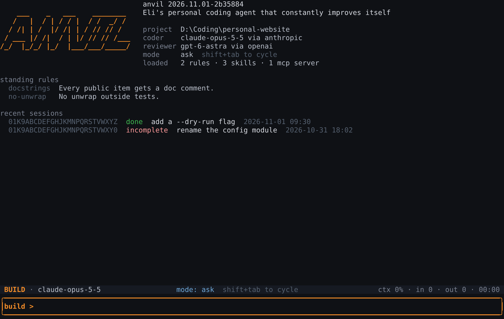
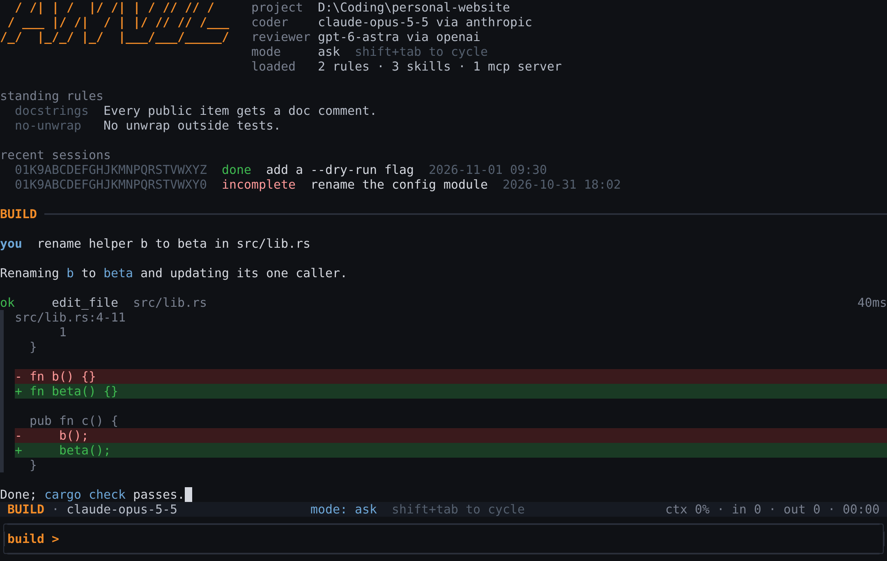
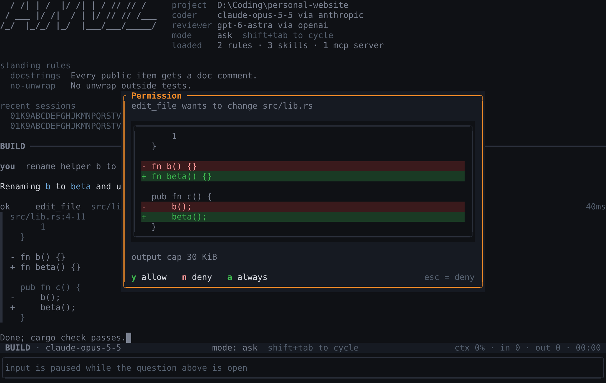
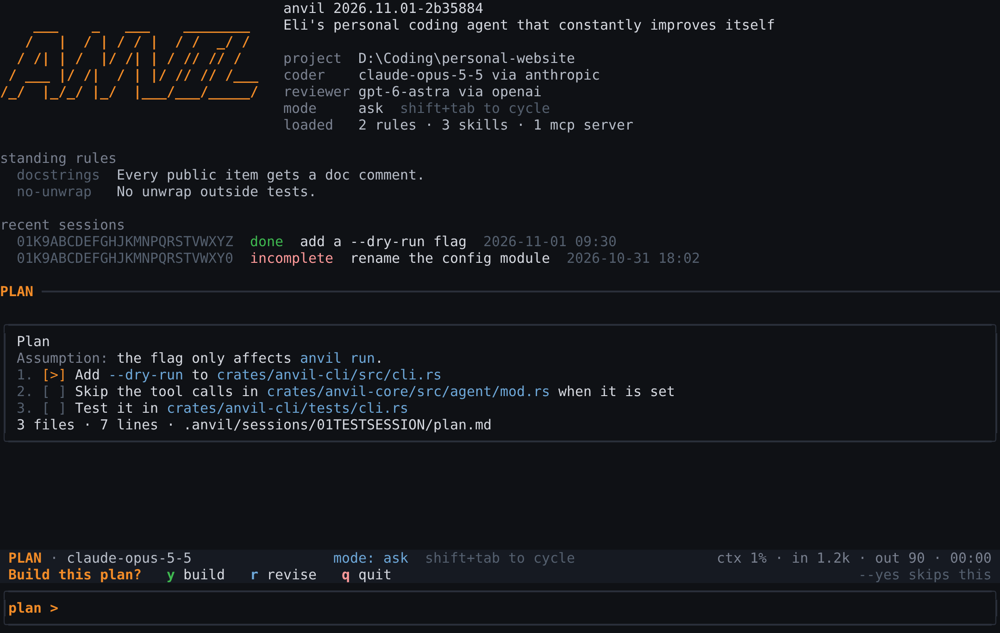

# Anvil

Anvil is a coding agent harness for open-weight models in regulated, restricted-network environments.

It is a terminal program written in Rust. It talks to a self-hosted, OpenAI-compatible model server (vLLM, llama.cpp, an internal gateway); hosted APIs (Anthropic, OpenAI) are a configuration option, not a default. Models are configuration, not code: any endpoint can play any role.

## What it is

A coding agent for your own projects. Point it at a repository, give it a task, and it plans, builds, reviews and verifies the change with a real tool set (shell, files, search) under a permission model you control. It reads Claude Code's conventions (`CLAUDE.md`, `SKILL.md`, `.claude/commands`, `.claude/agents`, hooks, MCP servers), so an existing Claude Code setup works as is. It remembers standing rules and facts across sessions, and it records what it does (sizes, tokens, latencies, outcomes), never what it works on. It is one binary with no background process and no account.

## Install

A release build: download the binary for your platform (`anvil-x86_64-unknown-linux-gnu`, `anvil-x86_64-unknown-linux-musl` for a static build that runs on any distribution, `anvil-x86_64-pc-windows-msvc.exe` or `anvil-aarch64-apple-darwin`) and `SHA256SUMS` from the [releases page](https://github.com/EliFebres/anvil/releases). Check the hash (`sha256sum --check --ignore-missing SHA256SUMS`) and, with the GitHub CLI, where it was built (`gh attestation verify <file> --repo EliFebres/anvil`), then rename it to `anvil` (`anvil.exe`) and put it on your `PATH`. Each release also carries a CycloneDX SBOM (`anvil.cdx.json`). anvil does not update itself: a newer version comes from wherever you got this one.

From source, with a Rust toolchain (edition 2024, rust-version 1.89 or newer) and git; Windows, macOS and Linux all work, and HTTP uses rustls, so there is no OpenSSL to install:

```sh
git clone https://github.com/EliFebres/anvil
cd anvil
cargo build --release      # target/release/anvil
```

### Building offline

Each release carries `anvil-<version>-vendored-src.tar.gz`: the tagged source with every dependency in `vendor/` and a `.cargo/config.toml` that points cargo there:

```toml
[source.crates-io]
replace-with = "vendored-sources"

[source.vendored-sources]
directory = "vendor"
```

On a machine without network access, with the Rust toolchain named in `rust-toolchain.toml` already installed:

```sh
tar -xzf anvil-<version>-vendored-src.tar.gz
cd anvil-<version>
cargo build --release --locked --offline    # target/release/anvil
```

`--locked` refuses to build if `Cargo.lock` would change, and `--offline` refuses any download, so the build uses exactly the reviewed dependencies.

## Configure a provider

Let anvil write its configuration:

```sh
anvil setup
```

This writes `~/.anvil/.env` (the key) and `~/.anvil/config.toml` with one example provider, `endpoint`: a self-hosted, OpenAI-compatible server at `https://models.internal.example/v1`, used for every role. It never overwrites a value that is already filled in, and exits 2 while a placeholder remains. Replace the URL and model (or use `--endpoint` below), fill in the key, then check everything:

```sh
anvil doctor
```

Better, point setup at your model server (vLLM, llama.cpp, an internal gateway). It reads the server's model list, writes one `endpoint` provider with the context size the server reports, and makes it every role:

```sh
anvil setup --endpoint https://gpu.example/v1 [--model <id>] [--key-env NAME]
```

The key is read from `ANVIL_ENDPOINT_KEY` (or `--key-env`); set it to any value if the server needs none. Non-loopback endpoints must use https unless `[network] allow_http_hosts` names the host. Under a managed policy that key is an error naming `[network] require_tls`: the policy alone decides plain http.

Every provider is a `[providers.<name>]` table naming its protocol, base URL, the environment variable that holds its key, the model and its context window; `[roles]` maps `coder`, `summarizer`, `reviewer` and the optional `planner` and `worker` onto those names. An open-weight model behind an OpenAI-compatible server looks like this:

```toml
[providers.local]
protocol = "openai"
base_url = "http://localhost:8000/v1"
api_key_env = "ANVIL_LOCAL_KEY"   # any value your server accepts
model = "<model name as served>"
context_window = 131072
supports_tools = true
supports_reasoning = false

[roles]
coder = "local"
summarizer = "local"
```

A hosted API is a provider like any other; setup never writes one. For example:

```toml
[providers.anthropic]
protocol = "anthropic"
base_url = "https://api.anthropic.com/v1"
api_key_env = "ANTHROPIC_API_KEY"
model = "<model id>"
context_window = 200000
supports_tools = true
supports_reasoning = true
```

Everything lives in your own `~/.anvil/`: `anvil config init --global` writes a commented template there. A repository's `.anvil/config.toml` can only add permission rules that refuse calls or make them ask (`anvil config init` writes that template); one that tries to set providers, roles, tools, network rules, the shell mode or `allow` rules stops anvil with an error naming the key. A repository's `.anvil/permissions.toml` may add `allow` rules, which apply only after you trust the repository, and any later change to them asks again. Keys never live in configuration files: they come from the environment or `~/.anvil/.env`, never from the repository, and `anvil scan-keys` fails if a tracked file contains one.

## Basic use

Work on a task in any repository:

```sh
cd ~/some-project
anvil "add a --json flag to the list command"
```

Or talk to it:

```sh
anvil chat
```

Scripts and CI get the line renderer automatically, or ask for it:

```sh
anvil --yes --plain run "bump the dependencies" > answer.txt
```

## Security model

- anvil never runs a model. It sends prompts, and the files and command output its tools read, over HTTPS to the endpoints you configure, through one HTTP client that does not follow redirects. It has no telemetry upload, no self-update and no update check.
- File writes, edits and shell commands ask first. Your own rules (in `~/.anvil/config.toml`, a `--profile`, or what `always` saved under `~/.anvil/permissions/`) change that; a repository can only add `deny` and `ask` rules. Network clients (`curl`, `wget`, `ssh` and the like), `git push`, `git clone`, `git remote add` and `set-url`, package installs, `sudo` and `runas`, and a few destructive commands (`rm -rf`, `git push --force`, `git reset --hard`, `Remove-Item -Recurse`) are refused even under `--yes` unless a rule names them. That check reads the command text, so it is a guard rail, not a boundary.
- Keys are read from the environment and `~/.anvil/.env`, never from configuration, and are not passed to the programs anvil starts, git included: those get a short list of variables plus `[tools] pass_env`. An MCP server definition's `${VAR}` references may only name variables from that list.
- The file tools stay inside the project (plus `[tools] extra_dirs`), reads included, and never open `.env` files, key and certificate files (`*.pem`, `*.key`, `id_rsa*`, ...), credentials files, `.git/config`, SSH or cloud credentials, browser profiles or keychains.
- `[shell] mode` sets how commands run: `ask` (the default), `allowlist` (one listed program with plain arguments, started without a shell; `profiles/strict.toml` uses it) or `off`. `[shell] executor = "container"` runs commands in docker or podman without network access. In `ask` mode on the host an approved shell command still runs with your own rights; anvil does not sandbox it.
- An administrator can install a managed policy (`/etc/anvil/policy.toml` on Linux and macOS, `C:\ProgramData\anvil\policy.toml` on Windows, owned by an administrator) that limits hosts, models, permissions, files, features, transcripts and spending, and that nothing below it can loosen: a conflicting setting is an error naming the policy key. `policies/` holds two examples, `docs/ADMIN_GUIDE.md` lists every key, `anvil policy show` and `anvil policy check <file>` inspect it, and `anvil doctor` shows it.
- anvil does not trust the repository it runs in. Its hooks, MCP servers, skills, commands, agents and instruction files load only after you answer the trust prompt, which lists each of them, and the answer is tied to a SHA-256 digest of that content, so any change asks again; `anvil trust` asks again and `anvil trust --revoke` withdraws it. Without a terminal, an undecided repository is untrusted.

[SECURITY.md](SECURITY.md) has the details, with file references and the test behind each control: what is enforced and what is not, every network destination and what triggers it, what is stored where, where keys come from, the permission defaults, the managed policy, and how releases are built. For a firm's reviewers, `docs/enterprise/` holds the data flow, the threat model and a pilot scope template; `policies/` holds the example policies (`restricted.toml`, `standard.toml`) and `docs/ADMIN_GUIDE.md` explains how to install and write one; `docs/ROADMAP.md` lists what is deliberately not done yet; `docs/CODE_TOUR.md` walks one request through the code.

## What it does

### The CLI

| command | what happens |
|---|---|
| `anvil "<task>"` or `anvil run <task>` | One task through the state machine: `plan` (you approve the plan, which ends with a `Check:` command) → `build` → `verify` (your rules, the project's checks and the plan's check, with no model turn) → `review` (a second model, which sees the check output). A project with no check command at all is reviewed first and then verified by the model. Exit code 0 when done, 2 when incomplete. |
| `anvil chat` | A conversation with tools, outside the state machine. `/plan`, `/build` and `/review` switch the prompt and tool set; `rule: <text>` saves a standing rule on the spot; `/compact`, `/model <name>`, `/cost`, `/help`. |
| `anvil build <spec.md>` | Work through a specification across many sessions: a plan of work items, one fresh session per item, a commit per finished item. See [Long builds](#long-builds). `anvil build resume [id]` continues one, `anvil build status [id]` shows it. |
| `anvil resume <id>` | Continue a saved session from where it stopped. `anvil sessions` lists them. |
| `anvil status [--json] [--all]` | Where every session of this project stands, newest first: state, loop step, age, spend, task, id. See [Watching a session](#watching-a-session). |
| `anvil --yes ...` | Unattended: approve the plan, allow every asked tool call, keep every proposed memory. Deny rules, the shell mode and the deny categories still apply. |
| `anvil --plain ...` | Keep the line renderer and stdin prompts. Chosen automatically when a standard stream is not a terminal. |
| `anvil --profile <name> ...` | Layer `~/.anvil/profiles/<name>.toml` over the config; its `[permissions]` table replaces your saved rules for the repository. |

#### The full-screen UI

`anvil chat`, `anvil run` and `anvil resume` open a full-screen terminal UI: a scrolling transcript, a status line (state, model, permission mode, tokens, cost, context used, elapsed time) and a multi-line input with history and Tab completion of slash commands. Shift+Enter, Alt+Enter or Ctrl+J insert a line break; Shift+Tab cycles the permission mode; Ctrl+C cancels the turn, twice quits; `?` on an empty input lists the keys.

<table>
  <tr>
    <td width="50%">
      
      <p align="center"><b>Startup.</b> What is loaded, your standing rules and the last few sessions.</p>
    </td>
    <td width="50%">
      
      <p align="center"><b>A build turn.</b> Every edit shows as a diff under its tool line; Enter expands any tool call.</p>
    </td>
  </tr>
  <tr>
    <td width="50%">
      
      <p align="center"><b>Permission.</b> An <code>ask</code> rule pauses the turn and shows exactly what would change.</p>
    </td>
    <td width="50%">
      
      <p align="center"><b>Plan approval.</b> Build it, send it back with feedback, or quit. The boxes tick as the model works through them.</p>
    </td>
  </tr>
</table>

Three kinds of state live under `~/.anvil/`, all plain files you can edit:

- **Rules** (`rules.toml`): standing coding rules. They enter the system prompt, the reviewer reports a violation as a note that cites the rule id (a note never sends the work back), and a rule with a `check` runs against the session's changed files in `verify`, where a failure does. `anvil rules list|add|remove|check`.
- **Memory** (`memory/`): one fact per line in `tooling.md`, `workflow.md` and `projects/<repo>.md`, loaded under a token cap. At the end of a session the summarizer proposes new facts and you keep or drop each one. A run that finished with no reviewer rejection, no failed check and a diff under 50 lines has nothing new to teach, so it skips that turn and says so; `[memory] always_summarize = true` runs it every time.
- **Telemetry** (`telemetry/<date>.jsonl`, with a copy in the project's `.anvil/`): content-free records of every session. `anvil stats --since 7d` sums them up with cost estimates, and with a planner configured adds a per-role table, each role priced by its own provider. They never leave the machine.

#### Workers

The `delegate` tool hands a piece of work to a subagent with its own conversation, so a broad search or an independent step does not fill the main one. Two agents ship with anvil and need no files in the project:

- `explore` has the read-only tools and returns a short answer with file paths and line numbers.
- `implement` has the write tools and the shell, under the same permission rules and prompts as the session (`permissions: inherit` in its definition), takes one self-contained step and returns what it changed.

Both run on the `worker` role, which is optional in `[roles]` and falls back to the coder; an agent definition's `model:` may name `worker`, `planner`, `coder` or a provider. A file of the same name in the project's or your own `.claude/agents/` replaces a built-in one.

Several `delegate` calls in one turn run at the same time, at most four, when the agent can only read; calls to an agent that may write run one after another, and while planning such a call is refused. Delegated turns appear under `worker` in the session's totals and draw on the same session budget. The Plan and Build prompts say when delegation pays for itself; `[prompt] delegate_guidance = false` removes that guidance.

#### Watching a session

Every `run`, `resume` and `chat` keeps a `status.json` in its session folder (`.anvil/sessions/<id>/`), replaced atomically on every change, so you can see from outside whether a session is working, stuck or waiting for you. `state` is one of `working`, `needs_input` (a permission prompt, a plan approval or a question is waiting), `blocked` (a budget ran out, the provider cannot be reached, or the loop stopped unfinished; `detail` says which), `done` and `failed`. It also holds the loop step, the tokens and cost so far, and when it started and last changed.

`anvil status` lists the sessions of the current project from those files; `--json` prints them as a JSON array and `--all` covers every project that has run a session. A session that says `working` or `needs_input` but whose process is gone shows as `stale` (the running process holds a lock on `status.lock`; `stale` is never written to the file). Sessions from before status files existed are skipped.

#### Long builds

`anvil build <spec.md>` hands anvil a specification and lets it work for a long time without one conversation growing until it fails. The planner role (the coder when there is none) splits the specification into work items, each with a title, a description, the area it concerns and an acceptance command that must exit 0. You approve the list the way you approve a plan (approve, revise with feedback, or abort; `--yes` skips it). Each item then runs as its own session through the normal plan, build, review and verify loop, which sees only the item, the specification (the whole file up to 24,000 characters, otherwise the section the planner named) and a short summary of the items already finished. An item is done only when anvil itself has run its acceptance command and the project's own check and both exited 0; the model's opinion never counts. The acceptance command, and a check anvil detected, pass the same shell mode, deny categories and permission rules as a model's `shell` call first (an `ask` asks you unless `--yes` was given), and `anvil build` does not start while `[shell] mode = "off"`. Then everything is committed with the item's title as the message.

A build needs a git repository on a branch, with a clean tree: no tracked changes and no untracked files that are not ignored, so commit the specification first or keep it outside the repository. `.anvil/` is left out of that check and out of the build's commits; the build's files live in `.anvil/builds/<id>/`: one `NN-<slug>.md` per item, `spec.md` (a copy), `state.json` and the build's own `status.json`, with the same schema and notifications as a session's. A build never pushes and touches only the branch it started on and its own `anvil-build/<id>/...` branches.

```
$ anvil build docs/spec.md --budget-usd 5
build 01JC4ZQ8M2 planned: 3 work item(s)
$ anvil build status
build 01JC4ZQ8M2  needs_input  branch main
spec docs/spec.md
work item 2 (`Add the --shout flag`) failed 2 attempts: the acceptance command `cargo test shout` did not exit 0: ...; its last attempt is on branch `anvil-build/01JC4ZQ8M2/item-2-attempt-2`; fix the cause and run `anvil build resume 01JC4ZQ8M2`
spent 61204 tokens, $0.84; 2 of 3 item(s) left

 1. [done] Print the greeting  (attempts 1, 21877 tokens)  3f9a1c2e
 2. [failed] Add the --shout flag  (attempts 2, 39327 tokens)
 3. [pending] Document the flags  (attempts 0, 0 tokens)
$ git switch main && anvil build resume --budget-usd 8
resuming build 01JC4ZQ8M2: 2 item(s) left
```

`--budget-usd` and `--budget-tokens` cap the whole build and are checked between items; the build then stops as `blocked` with the reason, and `resume` accepts new caps. Each item's session gets an even share of what is left, through the usual session token limit. An item gets two attempts: after the first failure the second is told why; after the second, the build stops as `needs_input`, the failed attempt is committed on `anvil-build/<id>/item-<n>-attempt-<k>`, and your branch is back at the last good commit with a clean tree. `anvil build resume [id]` (the newest unfinished build by default) starts at the first item that is not done, even after a crash; an item left in progress has its changes saved to a side branch first. Exit code 0 when every item is done, 2 when the build stopped. A `--budget-usd` cap is only applied inside a session when the coder has a `price_per_mtoken`.

#### Rules and templates

Two more things build on those files.

**Rules by relevance.** Each rule lists the `languages` it applies to. A session sends the coder and the reviewer only the rules for languages present in the project (from file extensions, honoring `.gitignore`, at most 5,000 files), plus every `*` rule and any rule for a language anvil cannot detect. An empty project has no languages yet, so it gets every rule. A Python-only rule stays out of a Rust-only project; the prompt is otherwise unchanged. The reviewer uses the project's languages too, since the changed files are not known when the prompt is built.

**Project templates.** `~/.anvil/templates/<name>/` holds a directory tree and a `template.toml` with `name` (the directory name), a one-line `description` and `languages`. A directory without a valid `template.toml` is ignored with a warning.

```
$ anvil template save rust-cli --description "A small Rust CLI with clap"   # saves the current directory
$ anvil template save web ../site --force                                   # another directory, replacing `web`
$ anvil new rust-cli ./my-tool                                              # copies the tree, not template.toml
```

`template save` honors `.gitignore` and skips `.git/` and `.anvil/`, and refuses to overwrite a template without `--force`. `anvil new` creates the directory, or fills an existing one that holds no files other than dot-directories such as `.git`; an unknown name lists the templates you have. When a task starts in such an empty directory, the Plan prompt lists each template's name and description so the plan can start from the one that fits (`anvil new <name> .`); with files present or no templates, the prompt is unchanged.

Other commands: `anvil skill add|list|show|remove` (install Claude Code skills from a local folder), `anvil compat check <dir>` (report what a `.claude` folder would load), `anvil doctor` (keys, providers, tools, keys in tracked files), `anvil new`, `anvil template save`.

## Repository layout

| path | what it holds |
|---|---|
| `crates/anvil-types` | Shared types: provider and roles config, the managed policy, skill manifest, session status, and their validators. |
| `crates/anvil-core` | The agent loop, tool registry, provider adapters (OpenAI and Anthropic protocols) and context management. |
| `crates/anvil-compat` | Claude Code compatibility: skills, `CLAUDE.md`, commands, agents, hooks, the MCP client. |
| `crates/anvil-memory` | Cross-project memory and coding rules. |
| `crates/anvil-telemetry` | Content-free usage records and `anvil stats`. |
| `crates/anvil-tui` | The palette and pure layout helpers the full-screen UI draws with. |
| `crates/anvil-cli` | The `anvil` binary: argument parsing, wiring, the line renderer and the full-screen UI. |
| `skills/` | Claude Code-format skills that ship with anvil. |
| `SECURITY.md` | What is enforced and what is not, network destinations, stored files, keys, permissions, the managed policy and the release build, for a reviewer. |
| `docs/` | `enterprise/` (data flow, threat model, pilot scope), `ADMIN_GUIDE.md`, `ROADMAP.md`, `CODE_TOUR.md`, `DECISIONS.md`. |
| `policies/` | Example managed policies, `restricted.toml` and `standard.toml`, each parsed by a test. |
| `profiles/` | Profiles that ship with anvil, such as `strict.toml`. |

`CLAUDE.md` is the contract: conventions, which crate may depend on which, and what every check enforces.

## License

MIT or Apache-2.0, at your option: see [LICENSE-MIT](LICENSE-MIT) and [LICENSE-APACHE](LICENSE-APACHE). Contributions are accepted under the same terms.

## Development

With [`just`](https://github.com/casey/just) installed:

```sh
just check
```

That runs `cargo fmt --check`, `cargo clippy --all-targets -- -D warnings`, `cargo test --all`, the key scan, and a grep that keeps the program's old name out of the tree. CI runs the same on Ubuntu and Windows, and `main` is protected: code reaches it only through pull requests. Prompts and tool schemas are pinned with `insta` snapshots; `cargo insta review` after a deliberate change.

Releases are built by `.github/workflows/release.yml` when a version tag is pushed; SECURITY.md ("Release builds") lists what each release publishes and how to verify it. `just deny` runs the dependency gate (`deny.toml`) that CI runs. Changes are recorded in `CHANGELOG.md`.
