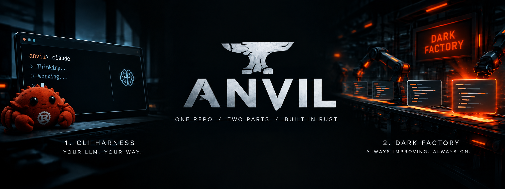

# Anvil

<p align="center">
  
</p>

Anvil is a coding agent you run from the terminal, plus an unattended service that keeps improving it. Both are Rust binaries in this workspace, they share one types crate, and they talk to each other through a file-based ticket queue with git history. Models are configuration, not code: any OpenAI- or Anthropic-protocol endpoint can play any role.

## What it is

**`anvil`, the CLI harness.** A coding agent for your own projects. Point it at a repository, give it a task, and it plans, builds, reviews, optimizes and verifies the change with a real tool set (shell, files, search) under a permission model you control. It reads Claude Code's conventions (`CLAUDE.md`, `SKILL.md`, `.claude/commands`, `.claude/agents`, hooks, MCP servers), so an existing Claude Code setup works as is. It remembers standing rules and facts across sessions, and it records what it does (sizes, tokens, latencies, outcomes), never what it works on.

**`factory`, the Dark Factory.** A service that works on anvil itself without anyone watching. It takes tickets that anvil's own telemetry drafted, implements each one on a branch inside a network-isolated container, runs the checks, scores the change against a fixed eval set, has several other models review it, and merges through a pull request when everything is green. Anything risky waits for a human.

## What it does

### The CLI

| command | what happens |
|---|---|
| `anvil "<task>"` or `anvil run <task>` | One task through the state machine: `plan` (you approve the plan) → `build` → `review` (a second model) → `optimize` → `verify` (the project's checks and your rules). Exit code 0 when done, 2 when incomplete. |
| `anvil chat` | A conversation with tools, outside the state machine. `/plan`, `/build` and `/review` switch the prompt and tool set; `rule: <text>` saves a standing rule on the spot; `/compact`, `/model <name>`, `/cost`, `/ticket <text>`, `/help`. |
| `anvil resume <id>` | Continue a saved session from where it stopped. `anvil sessions` lists them. |
| `anvil --yes ...` | Unattended: approve the plan, allow every asked tool call, keep every proposed memory. The factory and the eval harness run it this way. |
| `anvil --plain ...` | Keep the line renderer and stdin prompts. Chosen automatically when a standard stream is not a terminal. |
| `anvil --profile <name> ...` | Layer `~/.anvil/profiles/<name>.toml` over the config; its `[permissions]` table replaces the project's. |

`anvil chat` opens a full-screen terminal UI: a scrolling transcript, a status line (state, model, permission mode, tokens, cost, context used, elapsed time) and a multi-line input with history and Tab completion of slash commands. Shift+Enter, Alt+Enter or Ctrl+J insert a line break; `?` on an empty input lists the keys.

Three kinds of state live under `~/.anvil/`, all plain files you can edit:

- **Rules** (`rules.toml`): standing coding rules. They enter every system prompt, the reviewer must cite a rule id for any violation, and a rule with a `check` runs against the session's changed files in `verify`. `anvil rules list|add|remove|check`.
- **Memory** (`memory/`): one fact per line in `tooling.md`, `workflow.md` and `projects/<repo>.md`, loaded under a token cap. At the end of a session the summarizer proposes new facts and you keep or drop each one.
- **Telemetry** (`telemetry/<date>.jsonl`, with a copy in the project's `.anvil/`): content-free records of every session. `anvil stats --since 7d` sums them up with cost estimates. A classifier turns them into signals, and `anvil ticket draft` has the summarizer write ticket drafts from the signals alone.

Other commands: `anvil skill add|list|show|remove` (install Claude Code skills), `anvil compat check <dir>` (report what a `.claude` folder would load), `anvil doctor` (keys, providers, GitHub access, branch protection, tools), `anvil update` (fetch the latest release and swap the binary), `anvil ticket list|show|review|submit|drop`.

### The Dark Factory

A ticket is a TOML file: the symptom, the interface wanted, an optional reproduction, and the acceptance checks. The validator refuses any ticket that carries project code or paths outside this repository, so nothing about your own projects ever reaches the factory. `tickets/README.md` has the schema and lifecycle.

How a ticket moves:

1. `anvil ticket submit` pushes it on a `tickets/<id>` branch. That push is the only thing that ever leaves your machine toward the factory.
2. The service polls, copies the ticket onto the `factory/state` branch, and claims the highest-priority oldest one when `main` is green.
3. A worker makes a worktree on `factory/<id>` and runs `anvil --yes --profile factory` inside a container with no network, except an allowlisting proxy for the providers, GitHub and the crate registry.
4. Three gates: `just check` (one retry with the failure appended), the eval harness against the newest result on `main`, and the review swarm (several models, each with one stance: correctness, safety, style, simplicity; none may share a base URL with the coder).
5. A pull request opens with the gate output, the eval table and every verdict. Green CI squash-merges it. A change to a protected path or a new dependency is labelled `needs-human` and the ticket waits.

`factory run` is the loop (`--once` for a single pass), `factory status` shows the queue and the last ten outcomes, `factory pause` and `factory resume` toggle the flag it checks between tickets, `factory review <pr>` runs the swarm by hand, and `factory env <NAME>` says where a secret came from without printing it. Per-ticket budgets (wall clock, tokens) and the protected paths live in `factory.toml`.

### The eval harness

`crates/eval` scores a model or an anvil build against a fixed task set under `eval/`. `eval run` writes a result file, `eval compare` shows two side by side, `eval gate` exits 2 on a regression, and `eval baseline` runs every task three times on the coder role and commits the result that the factory gates against.

## Setup

You need a Rust toolchain (edition 2024, rust-version 1.88 or newer), git, and [`just`](https://github.com/casey/just). Windows, macOS and Linux all work; HTTP uses rustls, so there is no OpenSSL to install.

```sh
git clone https://github.com/EliFebres/anvil
cd anvil
cargo build --release
```

Then let anvil write its own configuration:

```sh
anvil setup
```

This writes `~/.anvil/.env` (API keys), `~/.anvil/config.toml` (providers and roles), `factory.toml` and `deploy/nuc/env.template`, never overwriting a value that is already filled in, and exits 2 while placeholders remain. Fill in the keys you have, then check everything:

```sh
anvil doctor
```

Every provider is a `[providers.<name>]` table naming its protocol, base URL, the environment variable that holds its key, the model and its context window; `[roles]` maps `coder`, `summarizer` and `reviewer` onto those names. A project can add `.anvil/config.toml` to override the global file, and `anvil config init` writes a template for either. Keys never live in config: `anvil scan-keys` fails if a tracked file contains one.

## Running

Work on a task in any repository:

```sh
cd ~/some-project
anvil "add a --json flag to the list command"
```

Or talk to it:

```sh
anvil chat
```

Scripts and CI get the line renderer automatically, or ask for it:

```sh
anvil --yes --plain run "bump the dependencies" > answer.txt
```

### Running the factory

The factory is meant for a small always-on machine. `deploy/nuc/bootstrap.sh` does the one-time setup over SSH (packages, Rust, the clone, the secrets file, the worker image, a systemd user unit), and `deploy/nuc/README.md` explains each file. On a machine that already has the binaries:

```sh
factory run --once     # one pass, for a first look
factory run            # the service loop
factory status
```

Secrets come from `~/.factory/env` (mode 600). The service needs `FACTORY_GITHUB_TOKEN`, a `factory.toml` at the repository root, and an eval result on `main` to gate against; until the baseline commit lands it pauses and says so. `anvil doctor --fix-github` creates the `factory/state` branch and the branch protection it expects.

## Repository layout

| path | what it holds |
|---|---|
| `crates/anvil-types` | The only code both binaries share: ticket schema, provider and roles config, telemetry references, skill manifest, and their validators. `cargo run -p anvil-types -- --schema` prints the Ticket JSON Schema. |
| `crates/anvil-core` | The agent loop, tool registry, provider adapters (OpenAI and Anthropic protocols) and context management. |
| `crates/anvil-compat` | Claude Code compatibility: skills, `CLAUDE.md`, commands, agents, hooks, the MCP client. |
| `crates/anvil-memory` | Cross-project memory and coding rules. |
| `crates/anvil-telemetry` | Usage records, failure classification, ticket drafts. |
| `crates/anvil-cli` | The `anvil` binary: argument parsing, wiring, the line renderer and the full-screen UI. |
| `crates/factory-core` | The ticket queue, worker loop, git operations and merge policy. |
| `crates/factory-review` | The multi-model review swarm. |
| `crates/factory-cli` | The `factory` binary. |
| `crates/eval` | The eval harness. |
| `skills/` | Claude Code-format skills that ship with anvil. |
| `tickets/` | The ticket queue; on `main` only an empty `open/`. |
| `deploy/nuc/` | Everything the factory machine needs. |

`CLAUDE.md` is the contract: conventions, which crate may depend on which, and what every check enforces.

## Development

```sh
just check
```

That runs `cargo fmt --check`, `cargo clippy --all-targets -- -D warnings`, `cargo test --all`, the key scan, and a grep that keeps the program's old name out of the tree. CI runs the same on Ubuntu and Windows, and `main` is protected: code reaches it only through pull requests. Prompts and tool schemas are pinned with `insta` snapshots; `cargo insta review` after a deliberate change.

Releases are built by `.github/workflows/release.yml`; `anvil update` downloads the latest one for your platform, verifies its SHA256 and swaps the binary in place.
