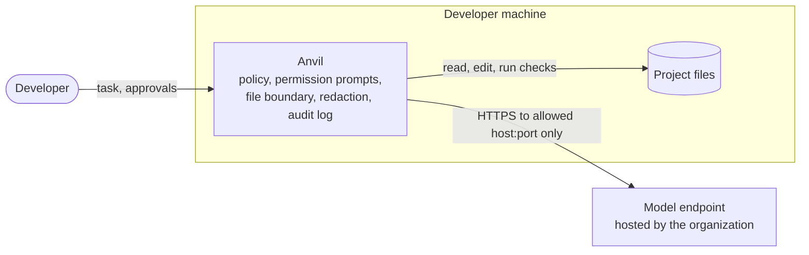

# Anvil

Anvil is a coding agent harness for open-weight models in regulated, restricted-network environments.

Anvil is a command-line program, one binary, that runs on the developer's machine. It gives a language model tools to read, edit and test code, under rules the organization sets in a policy file. It does not host or run a model: it sends requests to a model endpoint the organization operates, usually a self-hosted OpenAI-compatible server, and to no host the configuration or policy does not name. It has no server, no account, no usage upload and no self-update. Without a policy file it runs unmanaged: the developer's configuration names the endpoints, and writes and commands ask first. It holds no certification and has had no independent security assessment.

## How it works



In text: Anvil reads and changes project files and runs commands on the developer's machine, within the policy and the developer's answers to permission prompts. Anvil's own requests go only over HTTPS to the allowed `host:port` pairs: the model endpoint, plus any HTTP MCP server the configuration or a trusted repository names. Commands it runs are not covered. Every session writes a local audit log.

A task (`anvil "<task>"`) runs through four steps:

1. **Plan.** The model writes a plan; a person approves it or sends it back. `--yes` skips this unless the policy forbids it.
2. **Build.** The model edits files; each write and shell command asks first unless a rule decides.
3. **Verify.** Anvil runs the project's check command and the plan's; their exit codes decide, not a model. If a project has no check command at all, nothing deterministic runs; after review, the model checks the change itself with its tools.
4. **Review.** A second model call (optionally another model) reviews the change and the check output, and may send it back to Build at most three times.

## Why it is safe, and where it stops

Each control is enforced in code and proven by tests CI runs; the IDs refer to [docs/SECURITY_TESTS.md](docs/SECURITY_TESTS.md), and [SECURITY.md](SECURITY.md) explains each.

| control | what it does | proof |
|---|---|---|
| Network allowlist | Requests go only to allowed `host:port` pairs, over HTTPS except to loopback, without redirects, through one HTTP client. | NET-1 to NET-3, NET-7: `a_host_outside_the_allowed_set_is_refused_before_any_connection` |
| No phoning home | The binary has no self-update, update check, usage report or webhook. | NET-11: `removed_commands_are_not_part_of_the_binary` |
| Key handling | A key goes only to its own endpoint and is redacted from errors and logs; child programs get none. | NET-4, KEY-2, KEY-4: `a_child_process_that_prints_its_environment_shows_no_key` |
| Managed policy | An administrator-owned file at a fixed path outranks user, flag and repository settings; a conflict stops Anvil, naming the key. | POL-1 to POL-4: `a_profile_cannot_loosen_the_policy` |
| File boundary | File tools stay inside the project, refuse credential and key files, and never write files that grant permissions. | FS-1, FS-3, FS-5: `secret_paths_are_refused_inside_the_workspace_and_skipped_by_searches` |
| Permission prompts | File writes and shell commands ask a person when no rule decides. | PERM-6: `the_built_in_writing_tools_and_the_shell_ask_when_no_rule_decides` |
| Shell modes | The shell can be off, limited to listed programs started without a shell, or run in a docker or podman container without network access. | SH-1, SH-2, SH-5: `allowlist_mode_starts_the_program_without_a_shell` |
| Repository trust | A cloned repository can only tighten rules; its hooks, MCP servers and skills load only after the user trusts that exact content. | TRUST-1 to TRUST-3: `a_hook_added_after_trust_does_not_run_until_trusted_again` |
| Redaction | Known secret shapes in tool output are removed before reaching the model or disk; output is marked untrusted. | RED-1, RED-6: `a_secret_in_tool_output_does_not_reach_the_provider_or_the_transcript` |
| Data kept on disk | The policy decides whether transcripts keep text, only sizes and digests, or nothing. | DATA-1: `a_metadata_transcript_keeps_sizes_and_digests_but_no_text` |
| Audit log | Every session writes a hash-chained log of its events (prompts and arguments as sizes and digests by default), optionally mirrored, and stops when a required log fails. | AUD-1, AUD-5: `the_audit_chain_detects_edit_removal_and_reorder` |
| Release integrity | Tagged, locked release builds ship checksums, an SBOM and build provenance. | SUP-3, SUP-4: `release_publishes_checksums_an_sbom_vendored_source_and_provenance` |

[docs/CONTROLS.md](docs/CONTROLS.md) maps these to the NIST controls they support; Anvil claims compliance with no standard.

### What Anvil does not do

- **It does not sandbox approved shell commands on the host.** An approved command runs with the developer's rights and reaches any file or host they can. The container executor or `[shell] mode = "off"` is the boundary.
- **It does not keep data from the model endpoint.** Everything a session reads is sent there; redaction catches known key shapes, not passwords or customer data.
- **It does not prevent prompt injection.** The markers reduce it; permissions, the file boundary and the shell mode limit what follows.
- **It does not sign binaries** with a publisher certificate, store keys in an operating system credential store, or tie audit records to a single sign-on identity.
- **It cannot detect a local audit log cut at the end or rewritten whole**; a mirror the developer cannot rewrite covers that.

Full list: SECURITY.md, "What is not enforced"; also [docs/THREAT_MODEL.md](docs/THREAT_MODEL.md) and [docs/ROADMAP.md](docs/ROADMAP.md).

## Quick start for a developer

Install a verified release ([docs/ADMIN_GUIDE.md](docs/ADMIN_GUIDE.md)) or build it:

```sh
cargo build --release --locked                             # target/release/anvil
export ANVIL_ENDPOINT_KEY=...                              # any value if no key is needed
anvil setup --endpoint https://models.internal.example/v1  # writes ~/.anvil/config.toml
anvil doctor                                               # checks keys, provider, policy
anvil doctor --egress                                      # lists destinations, sends nothing
cd ~/some-project && anvil "add a --json flag to the list command"
```

The key comes from the environment or `~/.anvil/.env`, never a configuration file. [docs/USAGE.md](docs/USAGE.md) covers configuration and every command.

## For administrators

The policy file is `/etc/anvil/policy.toml` (Linux, macOS) or `C:\ProgramData\anvil\policy.toml` (Windows). If anyone but an administrator can change it, Anvil refuses to start; if it is missing, Anvil runs unmanaged and says so at every session start. Start from `policies/restricted.toml`:

```toml
version = 1
[network]
allowed_hosts = ["models.internal.example:443"]
[shell]
mode = "allowlist"
allow = ["cargo test *", "git diff *"]
[audit]
required = true
mirror_dir = "/var/log/anvil"
```

Under a policy, `allowed_hosts` is the only list of destinations. Keys left out take the restrictive default: no shell, MCP servers, repository trust, `--yes` or transcript. An allowed program such as `cargo test` still runs project code; the container executor contains it.

- `anvil policy check --ownership <file>` validates a file; `anvil policy show` prints the one in force.
- Verify a release with `sha256sum --check --ignore-missing SHA256SUMS` and `gh attestation verify <file> --repo EliFebres/anvil`.
- The audit log is `audit.jsonl` in each session folder (`<project>/.anvil/sessions/<id>/` or the policy's `transcript_dir`), copied to `mirror_dir`; `anvil audit verify <file>` checks it.

[docs/ADMIN_GUIDE.md](docs/ADMIN_GUIDE.md) has every key, Windows setup and air-gapped installation. Report a vulnerability privately as SECURITY.md describes.

## Documentation

| document | what it holds |
|---|---|
| [SECURITY.md](SECURITY.md) | What Anvil reads, stores and sends, who sets the limits, what is not enforced, how to report a vulnerability. |
| [docs/SECURITY_TESTS.md](docs/SECURITY_TESTS.md) | Every security claim next to the test that proves it. |
| [docs/THREAT_MODEL.md](docs/THREAT_MODEL.md) | Assets, trust boundaries, actors, and the OWASP Top 10 for Agentic Applications mapped to mitigations. |
| [docs/CONTROLS.md](docs/CONTROLS.md) | Which NIST SP 800-53 and SP 800-171 controls Anvil's features support, with the test for each. |
| [docs/DEPLOYMENT.md](docs/DEPLOYMENT.md) | Reference layouts, the data flow diagram, the shared responsibility table. |
| [docs/ADMIN_GUIDE.md](docs/ADMIN_GUIDE.md) | Verifying a release, air-gapped installation, every policy key, rollout, audit collection, upgrades. |
| [docs/PILOT_SCOPE.md](docs/PILOT_SCOPE.md) | A template for a first, time-boxed trial. |
| [docs/ROADMAP.md](docs/ROADMAP.md) | What is not done yet, including the host sandbox, FIPS and code signing. |
| [docs/CODE_TOUR.md](docs/CODE_TOUR.md) | A reading order through the security code, with a test to run at each stop. |
| [docs/USAGE.md](docs/USAGE.md) | Configuration, every command, the full-screen UI, workers, long builds, memory, rules and templates. |
| [docs/DECISIONS.md](docs/DECISIONS.md) | Every design choice made while hardening Anvil, with the reason. |
| [docs/HARDENING_REPORT.md](docs/HARDENING_REPORT.md) | What the hardening run did and did not do. |
| [CHANGELOG.md](CHANGELOG.md) | What changed in each version. |
| `policies/`, `profiles/` | Example managed policies and the `strict.toml` profile, each parsed by a test. |

## Development

Anvil is a Rust workspace; [CLAUDE.md](CLAUDE.md) holds the conventions. `just check` runs formatting, clippy, tests and `anvil scan-keys`, as CI does on Ubuntu and Windows.

## License

MIT or Apache-2.0, at your option: see [LICENSE-MIT](LICENSE-MIT) and [LICENSE-APACHE](LICENSE-APACHE).
