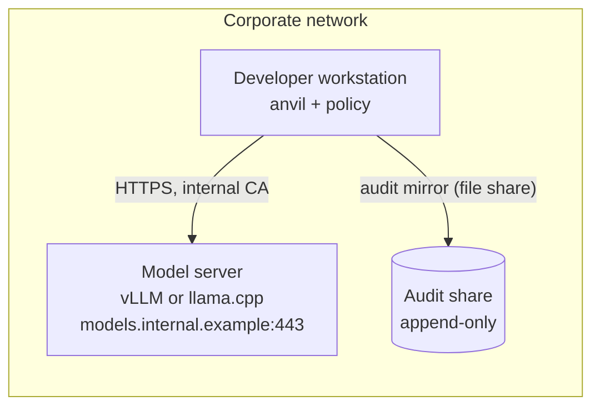
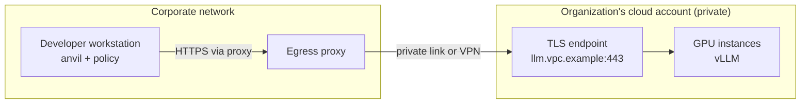
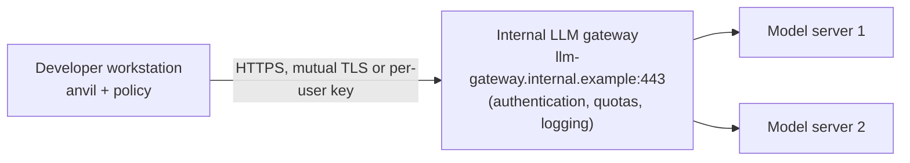
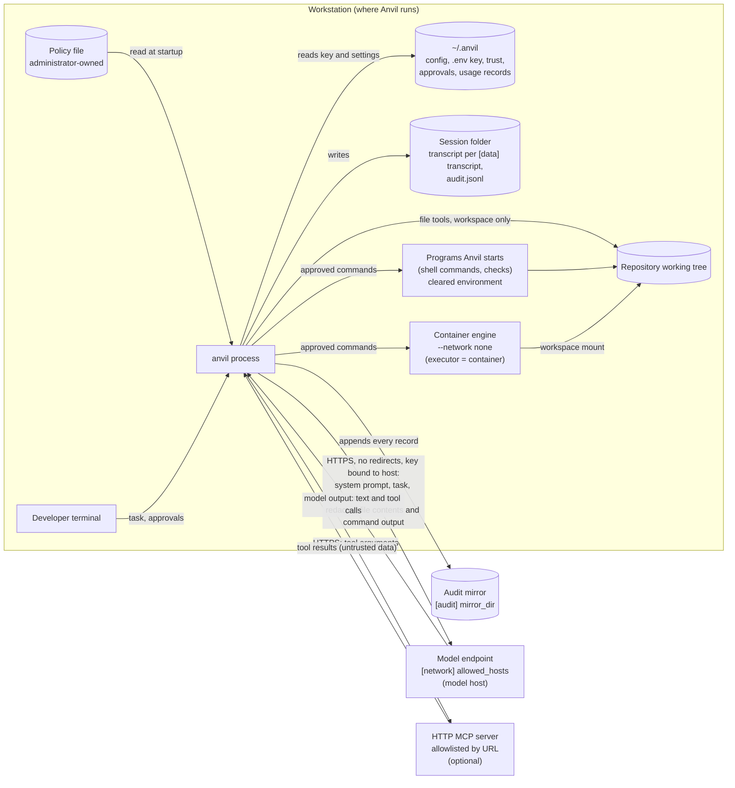

# Deployment

How Anvil fits into an organization's network: three reference layouts, the data flow, and who is responsible for what. [ADMIN_GUIDE.md](ADMIN_GUIDE.md) has the installation steps and every policy key; [THREAT_MODEL.md](THREAT_MODEL.md) has the risks.

Anvil is one binary with no server component, no background process and no account. It runs as the developer, on the machine where the developer works, and talks to one or more model endpoints over HTTPS. Everything below is the same on Windows, macOS and Linux.

## Reference layouts

All three use a managed policy. The policy's `[network] allowed_hosts` names exactly the endpoint the layout uses, and the firewall should allow the same: `anvil doctor --egress` on a pilot workstation prints the list to compare with the firewall rules.

### A: On-premises model server

- The model server runs an OpenAI-compatible API (vLLM, llama.cpp server, or similar) behind TLS with a certificate from the internal CA.
- Policy: `allowed_hosts = ["models.internal.example:443"]`, `ca_bundle` pointing at the internal root, `proxy = "none"`. Optionally `client_cert` and `client_key` when the server requires mutual TLS.
- `[audit] mirror_dir` points at a share developers can append to but not rewrite; IT collects it.
- Suits a fully air-gapped network: install Anvil from the vendored source archive or a verified binary (see ADMIN_GUIDE.md, "Air-gapped installation").

### B: Private cloud GPU

- The model runs on GPU instances in the organization's own cloud account, reached over a private link or VPN; the endpoint is not on the public internet.
- Policy: `allowed_hosts` names the private endpoint; `proxy` is the egress proxy's URL (or `"system"` when the workstation's proxy settings are the managed source); `ca_bundle` as needed. Anvil checks the endpoint's `host:port` itself, whatever the proxy allows.
- The cloud account's logging, retention and access to the GPU instances belong to the model host role (here, the organization's cloud team).

### C: Workstation to an internal gateway

- A gateway in front of several model servers authenticates users, applies quotas and logs requests; Anvil sees one endpoint.
- Policy: `allowed_hosts` names only the gateway; `[models] providers` and `models` restrict which entries the user's configuration may name. The key the gateway issues lives in the developer's environment or `~/.anvil/.env` and goes only to the gateway's `host:port`.
- Different roles (coder, reviewer, planner) can name different models behind the same gateway.

## Data flow

What crosses each line when a session runs under a policy. Nothing else leaves the workstation: there is no telemetry, update check, analytics, web search or web fetch (SECURITY.md, "Network: where requests may go").

- **To the endpoint.** Each request carries the system prompt (Anvil's instructions, the user's `~/.anvil/ANVIL.md`, a trusted repository's instruction files), the task and the conversation so far: the model's earlier answers, its tool arguments, and what each tool returned, after redaction. That includes the contents of files the tools read and the output of commands that ran. The key goes in a header, only to the endpoint's own `host:port`.
- **On the workstation.** The transcript keeps what the policy's `[data] transcript` says (`off` by default under a policy); the audit log is always written; usage records are content-free.
- **Not covered by Anvil's egress check.** Approved commands on the host make their own connections (a build that downloads dependencies, for example). Local MCP servers and hooks are programs too. Under a policy all three are off by default; `[shell] executor = "container"` gives commands no network at all. Where commands run on the host, network control around the workstation is the organization's.

## Shared responsibility

| area | Anvil | model host | organization's IT |
|---|---|---|---|
| Where requests go | Enforces the allowed `host:port` set, https, no redirects, key bound to host (`NET-1` to `NET-6`) | Exposes the endpoint only where intended | Sets `allowed_hosts`; firewall and proxy rules that match it |
| TLS | Verifies the server with the system store or the policy's CA bundle; presents a client certificate if set | Serves a valid certificate; requires mutual TLS if wanted | Runs the internal CA; issues client certificates; decides on FIPS needs (Anvil makes no FIPS claim) |
| Endpoint authentication | Reads the key from the environment or `~/.anvil/.env`, sends it only to its host | Issues, rotates and revokes keys; authenticates requests | Distributes keys; prefers short-lived credentials where the host supports them |
| Prompts and data sent | Redacts known secret shapes and the policy's patterns before sending (`RED-1`, `RED-2`) | Retention, access control and logging of everything it receives; deletion on request | Decides which repositories and data Anvil may be used on; adds `[data] patterns` for internal identifiers |
| What the agent may do on the workstation | Permission check, file boundary, shell modes, deny categories, protected files (`PERM-*`, `FS-*`, `SH-*`) | Nothing | Chooses the policy (`[shell] mode`, `executor`, `[permissions]`), the operating system account and any sandbox around Anvil |
| Repository content | Tightening-only rules until trusted; trust pinned by digest (`TRUST-*`) | Nothing | Decides `[projects] allow_trust`; reviews what developers trust |
| Extensions (MCP, hooks, skills) | Off under a policy unless allowed; MCP listings pinned by digest | Nothing | Vets and allowlists servers; pins `listing_sha256` |
| Records | Writes the hash-chained audit log, the mirror, transcripts per policy; fails closed when required (`AUD-*`) | Its own request logs | Provides and collects `mirror_dir`; reviews logs; sets `retention_days`; disk encryption |
| The model | Nothing: treats model output as untrusted actions | Model provenance, version, patching, availability | Chooses the model and the host |
| The Anvil binary | Reproducible locked builds with checksums, SBOM, provenance, vendored source (`SUP-*`) | Nothing | Verifies a release, distributes it, pins the version, upgrades by hand |
| Policy file | Refuses an unsafe, broken or unknown-key policy; reports its hash (`POL-*`) | Nothing | Writes, reviews, rolls out and owns the file |
| Code the agent writes | Plans, runs checks, has it reviewed by a second model; shows every change as a diff | Nothing | Pull request review by a person before merge |

## Pilot

[PILOT_SCOPE.md](PILOT_SCOPE.md) is a template for a first, time-boxed pilot: the people, repositories, data rules, policy settings and the conditions for stopping.
