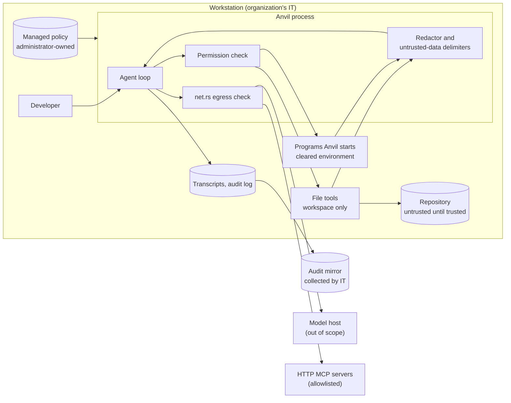

# Threat model

Anvil is a coding agent harness for open-weight models in regulated, restricted-network environments. This document names what Anvil protects, where the trust boundaries are, who might act against it, and how each entry of the OWASP Top 10 for Agentic Applications 2026 maps to Anvil's mitigation, the risk that remains and who owns it.

The model and the machine it runs on are out of scope: whoever hosts them secures them. Anvil's part is everything above the model on the machine where Anvil runs: what the agent may read, run, send and store, who controls those limits, and what record is left behind. Each mitigation below cites a claim in [SECURITY_TESTS.md](SECURITY_TESTS.md) (`NET-1`, `FS-3`, ...), where the test that proves it is named. A mitigation without such a claim is not described as present.

## Assets

| asset | where it lives | why it matters |
|---|---|---|
| Source code and data in the workspace | The repository Anvil runs in | It is what the session reads; it reaches the model host by design, and the agent can change it. |
| Secrets on the machine | `.env` files, key and certificate files, SSH and cloud credentials, browser profiles, keychains, environment variables | A leaked credential reaches systems far beyond the workstation. |
| The model endpoint key | The environment or `~/.anvil/.env` | It grants use of the model host and, for a hosted API, spending. |
| The user's configuration and grants | `~/.anvil/` (`config.toml`, `trust.toml`, `permissions/`, `mcp-approvals.toml`) and the repository's `.anvil/permissions.toml`, `.mcp.json`, settings files | Changing them changes what the agent may do next session. |
| The managed policy | `/etc/anvil/policy.toml`, `C:\ProgramData\anvil\policy.toml` | It is the organization's limit on every session. |
| Session records | Transcripts, the audit log and its mirror, usage records, logs | They hold redacted content (in `full` mode) and are the evidence of what happened. |
| The workstation itself | Files and network reachable with the user's rights | An approved command runs with those rights. |

## Trust boundaries

| boundary | what crosses it | what Anvil enforces at it |
|---|---|---|
| Anvil process to model host | Prompts, file contents and command output the tools read; model output comes back | Only allowed `host:port` pairs, https except loopback, no redirects, key bound to its host (`NET-1` to `NET-6`); secrets redacted first (`RED-1`, `RED-2`). |
| Model output to actions | Tool calls the model asks for | The permission check, the file boundary, the shell mode, the deny categories (`PERM-1`, `FS-1` to `FS-6`, `SH-1` to `SH-5`). |
| Tool, file and MCP output to the model | Text from the repository, programs and servers | Redaction and untrusted-data delimiters with a per-session nonce (`RED-1` to `RED-6`). |
| Repository to Anvil's configuration | `.anvil/`, `.claude/`, `.mcp.json`, instruction files | Tightening only until trusted; trust pinned to a digest (`TRUST-1` to `TRUST-7`). |
| Anvil to the programs it starts | Environment, arguments | Cleared environment, no keys (`KEY-4`, `KEY-5`); allowlist and container modes (`SH-2`, `SH-3`, `SH-5`). |
| User to policy | Configuration, profiles, flags, `ANVIL_HOME` | A conflict with the policy is an error (`POL-4`); the policy file must be administrator-owned (`POL-2`). |
| Anvil to its records | Audit records, transcripts | Hash chain, canonical form, fail-closed writes, a mirror outside the session folder (`AUD-1` to `AUD-6`). |

## Actors

### Hostile repository content

A cloned repository tries to make Anvil act against the developer: send the key to its own server, run commands without asking, plant instructions, or read the developer's secrets.

- **Mitigated.** A repository's `.anvil/config.toml` that sets providers, URLs, roles, tools, network or shell settings, or a loosening permission key, stops Anvil (`TRUST-1`). Its `.env` is never loaded (`KEY-1`). Its hooks, MCP servers, skills, commands, agents and instruction files load only after the developer trusts that exact content, and any change asks again (`TRUST-2`, `TRUST-3`, `TRUST-4`); a policy can forbid trust entirely (`TRUST-5`). An instruction file cannot import a file outside the repository (`TRUST-6`). A detected check command asks first (`SH-8`). Anvil's own git calls run no hook or repository-named program (`SH-7`).
- **Remains.** Text in ordinary files can still try to persuade the model (see ASI01). After trust, the repository's hooks run as the developer.

### Poisoned file or tool output

Text the agent reads (a source comment, a README, command output, an MCP server's result or tool description) carries instructions meant for the model.

- **Mitigated.** Tool output, file contents, MCP results and hook output reach the model inside delimiters it is told to treat as data, and content cannot close them (`RED-6`). Secrets in that text are redacted first (`RED-1` to `RED-3`). A changed MCP tool listing stops the server (`TRUST-7`). Whatever the model then asks for still passes the permission check and the boundaries.
- **Remains.** A model can follow injected text. The limit is what the permission rules, the shell mode and the file boundary allow.

### A compromised or misbehaving model endpoint

The model host is breached, or the model returns harmful tool calls, by design or by error.

- **Mitigated.** The endpoint receives only what the session read, after redaction, and only at the allowed `host:port` (`NET-1`, `NET-4`); it cannot redirect Anvil elsewhere (`NET-2`). A key it echoes back is redacted (`KEY-2`). Its tool calls pass the same checks as any other: no write outside the workspace or to the files that grant power (`FS-1` to `FS-5`), no shell under `mode = "off"`, listed programs only under `allowlist`, no network inside the container (`SH-1` to `SH-5`). Every call and decision is in the audit log (`AUD-7`, `AUD-8`).
- **Remains.** Everything a session reads is sent to the endpoint; a breached host has it. In `ask` mode on the host, a person who approves a harmful command runs it.

### A careless user

The developer approves too much, runs unattended, points Anvil at the wrong repository, or loosens their own configuration.

- **Mitigated.** Under a policy, `--yes`, `--allow-tool`, saved `always` rules and `default = "allow"` are refused unless the administrator allows them, a person can be required to approve every plan, and no lower layer can loosen the policy (`POL-4`). The deny categories hold under `--yes` (`SH-4`). The files that grant power cannot be written by the file tools even with approval (`FS-5`).
- **Remains.** In `ask` mode a person can approve a harmful command. The organization's pull request review is the backstop for the code the agent writes.

## OWASP Top 10 for Agentic Applications 2026

Source: OWASP Gen AI Security Project, Agentic Security Initiative, "OWASP Top 10 for Agentic Applications for 2026", Version 2026, December 2025, licensed CC BY-SA 4.0. Landing page: <https://genai.owasp.org/resource/owasp-top-10-for-agentic-applications-for-2026/>; the document itself was downloaded from that page's link, <https://genai.owasp.org/download/52117/?tmstv=1765059207>, on 2026-11-19, and the identifiers and names below are copied from it. The descriptions in the first column are short paraphrases; read the document for the full text.

"Owner" names who holds the remaining risk: **Anvil** (a change to Anvil would reduce it), **model host** (whoever operates the model endpoint), or **IT** (the organization's IT and security teams, through policy, network and process).

| OWASP entry | Anvil's mitigation | remaining risk | owner |
|---|---|---|---|
| **ASI01: Agent Goal Hijack**. An attacker redirects the agent's goals or task selection through injected instructions, deceptive tool output or poisoned data. | Untrusted-data delimiters with a per-session nonce around every tool, file, MCP and hook result (`RED-6`); repository instructions load only after trust (`TRUST-2`, `TRUST-3`); a person approves the plan, and a policy can require it (`require_plan_approval`); whatever a hijacked goal leads to still passes the permission check and the boundaries (`PERM-1`, `FS-1`, `SH-1` to `SH-5`). | Delimiters are a mitigation; a model can still follow injected text, and in `ask` mode a person may approve the result. | Anvil (OS sandbox on the roadmap), IT (shell mode, pull request review) |
| **ASI02: Tool Misuse and Exploitation**. The agent applies legitimate tools unsafely, chaining them into exfiltration or destructive actions. | File tools confined to the workspace and refused on secret files and on the files that grant power (`FS-1` to `FS-6`); writes and commands ask by default; the shell can be off, allowlisted or containerized (`SH-1` to `SH-5`); deny categories for network clients, pushes, installs and destructive patterns (`SH-4`); egress only to allowed hosts (`NET-1`); Plan refuses writing tools. | An allowed program's own behaviour (`cargo test` runs code the model wrote); deny categories match text in `ask` mode. | Anvil (OS sandbox), IT (choose `allowlist` or `container`) |
| **ASI03: Identity and Privilege Abuse**. Delegation chains, inherited credentials or cached context let the agent escalate access. | Programs start without keys or secret-looking variables (`KEY-4`, `KEY-5`); keys go only to their own host (`NET-4`); subagents inherit the session's rules and limits, not more (`PERM-4`); a repository's `allow` never covers what the user did not allow (`PERM-1`); file tools refuse credential stores (`FS-3`). | Commands run with the developer's operating system identity; no per-session identity or short-lived token exists; audit records name the user from the environment. | IT (account and endpoint controls), Anvil (vault tokens and SSO identity on the roadmap) |
| **ASI04: Agentic Supply Chain Vulnerabilities**. Tools, plug-ins, MCP servers, models, agents or update channels are malicious or tampered with. | No self-update or download of code; skills install from a local folder only; MCP servers allowlisted by name and program or URL under a policy, their tool listings pinned by digest (`TRUST-7`); repository hooks, servers and agents only after trust (`TRUST-2`); releases with checksums, SBOM, vendored source and provenance attestations (`SUP-3`, `SUP-4`); pinned actions and least-privilege workflows (`SUP-1`, `SUP-2`); `cargo deny` in CI. | Binaries are not code-signed; an MCP server's own code is not inspected; the model weights are not Anvil's to verify. | IT (verify releases, vet MCP servers), model host (model provenance), Anvil (signed installers on the roadmap) |
| **ASI05: Unexpected Code Execution (RCE)**. Generated code or injected text turns into execution of scripts or binaries. | Shell off by default under a policy (`SH-1`); allowlist mode starts listed programs without a shell and refuses metacharacters and outside paths (`SH-2`, `SH-3`); container executor with no network, non-root, read-only root (`SH-5`, `SH-6`); detected checks and acceptance commands ask (`SH-8`); git hooks and repository-named programs never run on Anvil's git calls (`SH-7`); scripts a hook runs cannot be rewritten by file tools (`FS-6`). | In `ask` mode on the host an approved command runs unsandboxed; build scripts and tests run under `allowlist`; the container's workspace is writable, so code written there can run later on the host. | Anvil (OS sandbox), IT (policy `[shell]` choice, review before running outside the container) |
| **ASI06: Memory & Context Poisoning**. Stored context, memory or summaries are seeded with misleading data that steers later sessions. | Under a policy memory is off by default and nothing under `~/.anvil/memory` is read or written (`DATA-5`); below a `full` transcript the summarizer does not run (`DATA-5`); repository instruction files are pinned by the trust digest (`TRUST-3`); compaction summaries are redacted like the rest of the conversation (`RED-1`). | With memory on, the end-of-session summarizer proposes facts that a person keeps or drops (`--yes` keeps them all), so a poisoned fact can be kept; within one session, injected text stays in the context until compaction. | IT (`[features] memory` off), user |
| **ASI07: Insecure Inter-Agent Communication**. Messages between agents lack authentication or integrity and can be spoofed or altered. | Subagents run in the same process and share the session's guard, nonce, rules and audit chain; there is no network channel between agents (`PERM-4`, `AUD-7`). HTTP MCP traffic uses the checked client with TLS (`NET-1`, `NET-6`). Anvil implements no agent-to-agent protocol. | Limited to MCP servers, whose responses are treated as untrusted data. | Anvil |
| **ASI08: Cascading Failures**. One fault propagates across agents and tools into system-wide harm. | Token and spend ceilings per session and build (`[limits]`, `POL-6`); a build item counts as done only when its acceptance command and the project check pass, run by Anvil (`SH-8`); a failed required audit write stops everything (`AUD-5`); every change is an ordinary diff for review. | A wrong change that passes the checks can still be merged; a build commits each finished item to its branch. | IT (pull request review), user |
| **ASI09: Human-Agent Trust Exploitation**. Users over-rely on the agent and approve actions without independent validation. | Prompts show the exact command or diff; a policy can refuse `--yes`, saved `always` rules and pre-approval, and require plan approval (`POL-4`); deny categories and the protected files hold whatever a person answers (`SH-4`, `FS-5`); the audit log names who approved each call (`AUD-8`). | A person can still approve a harmful action in good faith. | IT (training, review process), user |
| **ASI10: Rogue Agents**. An agent deviates from its intended scope and acts harmfully while each action looks legitimate. | The agent's reach is fixed by configuration it cannot write (`FS-5`) and a policy it cannot change (`POL-1` to `POL-4`); every model request, tool call, decision and file change is in a hash-chained log with a mirror (`AUD-1` to `AUD-8`); budgets stop runaway sessions. | Detection is after the fact; the log does not record files a shell command changed. | IT (collect and review the mirror), Anvil (shell file changes in the audit log on the roadmap) |

## What this model does not cover

- The model host's own security (network exposure, authentication, prompt retention, patching). [DEPLOYMENT.md](DEPLOYMENT.md) lists what the host is responsible for.
- An attacker who already controls the developer's operating system account: they can edit `~/.anvil`, run any program, and rewrite the session's audit file (the mirror is the answer to the last one).
- Correctness and security of the code the model writes. Review it like any other change.

Items that would reduce the remaining risk are listed in [ROADMAP.md](ROADMAP.md).
