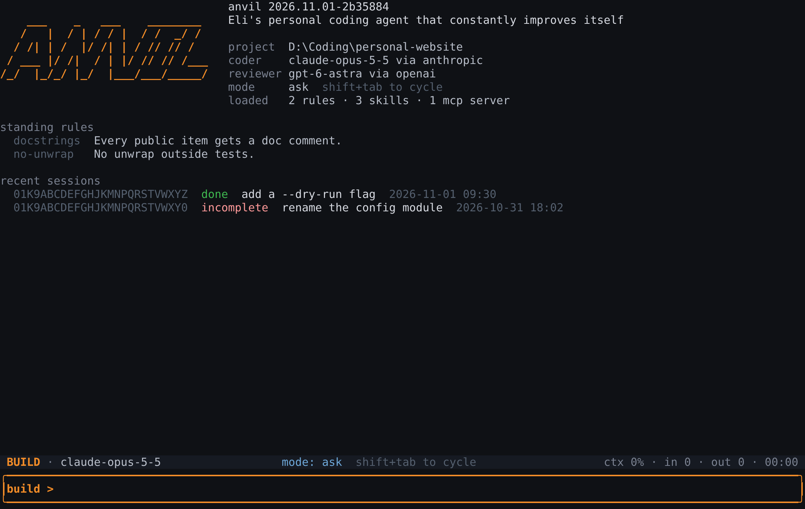
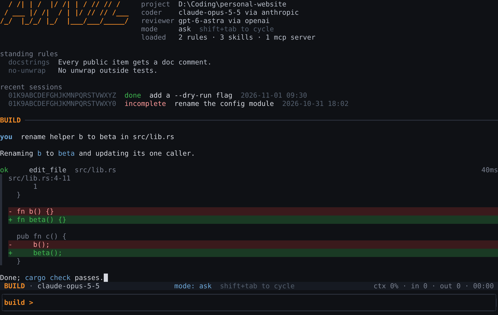
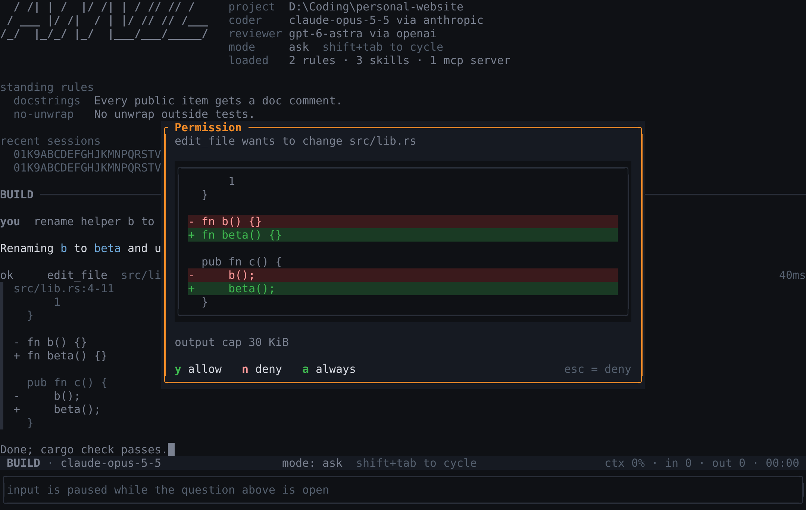
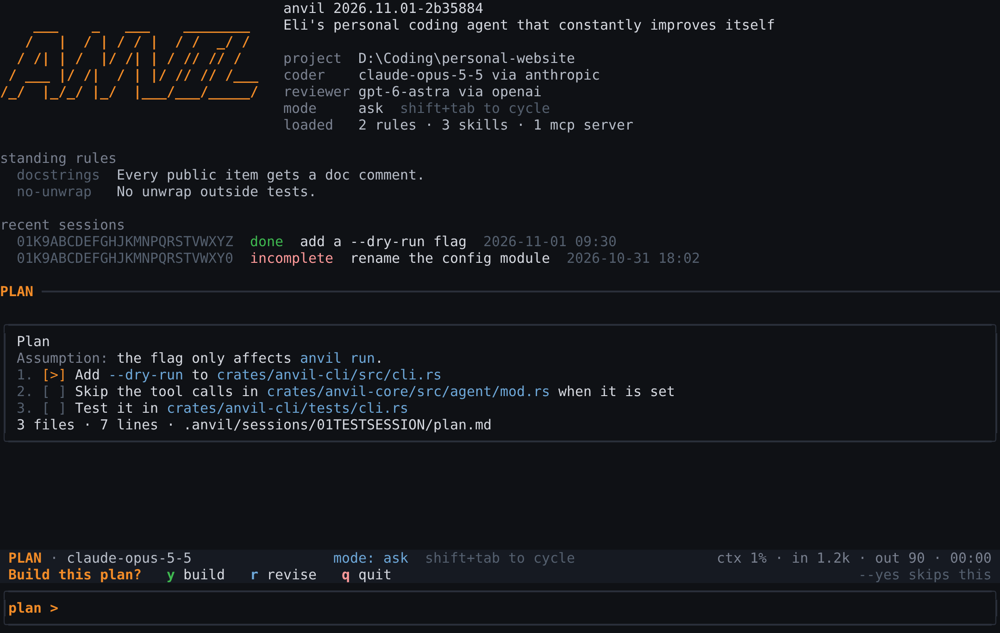

# Using Anvil

The commands, the full-screen UI, workers, session status, long builds, rules and templates. README.md has the quick start; SECURITY.md has what each feature may touch.

## Configuration

Build from source with the Rust toolchain named in `rust-toolchain.toml`:

```sh
git clone https://github.com/EliFebres/anvil
cd anvil
cargo build --release --locked      # target/release/anvil
```

`anvil setup --endpoint <url> [--model <id>] [--key-env <NAME>]` reads the server's model list, writes one `endpoint` provider with the context size the server reports, and uses it for every role. `anvil config init --global` writes a commented template instead. The key is read from the environment or `~/.anvil/.env`, never from a configuration file or the repository. A non-loopback endpoint must use https unless you list its host in `[network] allow_http_hosts` (unmanaged only). The written `~/.anvil/config.toml` looks like this:

```toml
[providers.endpoint]
protocol = "openai"
base_url = "https://models.internal.example/v1"
api_key_env = "ANVIL_ENDPOINT_KEY"
model = "<model name as served>"
context_window = 131072
supports_tools = true
supports_reasoning = false

[roles]
coder = "endpoint"
summarizer = "endpoint"
```

A hosted API is a configuration option, never a default. It is configured the same way, with `protocol = "anthropic"` or `"openai"`; under a managed policy its host must be in `[network] allowed_hosts`:

```toml
[providers.anthropic]
protocol = "anthropic"
base_url = "https://api.anthropic.com/v1"
api_key_env = "ANTHROPIC_API_KEY"
model = "<model id>"
context_window = 200000
supports_tools = true
supports_reasoning = true
```

`[roles]` may also name a `reviewer`, a `planner` and a `worker`, each a provider above; each falls back to the coder.

The first session in a repository that ships hooks, MCP servers, skills, commands, agents or instruction files asks whether to trust that content; until you do, none of it loads. A repository's own `.anvil/config.toml` can only add rules that refuse calls or make them ask (`anvil config init` writes that template).

## Basic use

Work on a task in any repository:

```sh
cd ~/some-project
anvil "add a --json flag to the list command"
```

Or talk to it:

```sh
anvil chat
```

Scripts and CI get the line renderer automatically, or ask for it:

```sh
anvil --yes --plain run "bump the dependencies" > answer.txt
```

## The CLI

| command | what happens |
|---|---|
| `anvil "<task>"` or `anvil run <task>` | One task through the state machine: `plan` (you approve the plan, which ends with a `Check:` command) → `build` → `verify` (your rules, the project's checks and the plan's check, with no model turn) → `review` (a second model, which sees the check output). A project with no check command at all is reviewed first and then verified by the model. Exit code 0 when done, 2 when incomplete. |
| `anvil chat` | A conversation with tools, outside the state machine. `/plan`, `/build` and `/review` switch the prompt and tool set; `rule: <text>` saves a standing rule on the spot; `/compact`, `/model <name>`, `/cost`, `/help`. |
| `anvil build <spec.md>` | Work through a specification across many sessions: a plan of work items, one fresh session per item, a commit per finished item. See [Long builds](#long-builds). `anvil build resume [id]` continues one, `anvil build status [id]` shows it. |
| `anvil resume <id>` | Continue a saved session from where it stopped. `anvil sessions` lists them. |
| `anvil status [--json] [--all]` | Where every session of this project stands, newest first: state, loop step, age, spend, task, id. See [Watching a session](#watching-a-session). |
| `anvil --yes ...` | Unattended: approve the plan, allow every asked tool call, keep every proposed memory. Deny rules, the shell mode and the deny categories still apply. |
| `anvil --plain ...` | Keep the line renderer and stdin prompts. Chosen automatically when a standard stream is not a terminal. |
| `anvil --profile <name> ...` | Layer `~/.anvil/profiles/<name>.toml` over the config; its `[permissions]` table replaces your saved rules for the repository. |

### The full-screen UI

`anvil chat`, `anvil run` and `anvil resume` open a full-screen terminal UI: a scrolling transcript, a status line (state, model, permission mode, tokens, cost, context used, elapsed time) and a multi-line input with history and Tab completion of slash commands. Shift+Enter, Alt+Enter or Ctrl+J insert a line break; Shift+Tab cycles the permission mode; Ctrl+C cancels the turn, twice quits; `?` on an empty input lists the keys.

The screenshots below are from an earlier build: the startup screen now also has a `policy` row (`unmanaged`, or the policy's path and hash), and they show hosted model names where a deployment would show its own endpoint's models (docs/ROADMAP.md, "Documentation").

<table>
  <tr>
    <td width="50%">
      
      <p align="center"><b>Startup.</b> What is loaded, your standing rules and the last few sessions.</p>
    </td>
    <td width="50%">
      
      <p align="center"><b>A build turn.</b> Every edit shows as a diff under its tool line; Enter expands any tool call.</p>
    </td>
  </tr>
  <tr>
    <td width="50%">
      
      <p align="center"><b>Permission.</b> An <code>ask</code> rule pauses the turn and shows exactly what would change.</p>
    </td>
    <td width="50%">
      
      <p align="center"><b>Plan approval.</b> Build it, send it back with feedback, or quit. The boxes tick as the model works through them.</p>
    </td>
  </tr>
</table>

State lives under `~/.anvil/` in plain files you can edit. Besides the three below, it holds your trust decisions (`trust.toml`), the rules an `always` answer saved (`permissions/`), MCP listing approvals (`mcp-approvals.toml`), saved project templates (`templates/`) and skills you installed for every project (`skills/`); the files table in [SECURITY.md](../SECURITY.md) lists each with what it holds.

- **Rules** (`rules.toml`): standing coding rules. They enter the system prompt, the reviewer reports a violation as a note that cites the rule id (a note never sends the work back), and a rule with a `check` runs against the session's changed files in `verify`, where a failure does. `anvil rules list|add|remove|check`.
- **Memory** (`memory/`): one fact per line in `tooling.md`, `workflow.md` and `projects/<repo>.md`, loaded under a token cap. At the end of a session the summarizer proposes new facts and you keep or drop each one. A run that finished with no reviewer rejection, no failed check and a diff under 50 lines has nothing new to teach, so it skips that turn and says so; `[memory] always_summarize = true` runs it every time.
- **Usage records** (the project's `.anvil/usage/<date>.jsonl`, with a copy in `~/.anvil/usage/`): content-free records of every session. `anvil stats --since 7d` sums them up with cost estimates, and with a planner configured adds a per-role table, each role priced by its own provider. They never leave the machine.

### Workers

The `delegate` tool hands a piece of work to a subagent with its own conversation, so a broad search or an independent step does not fill the main one. Two agents ship with anvil and need no files in the project:

- `explore` has the read-only tools and returns a short answer with file paths and line numbers.
- `implement` has the write tools and the shell, under the same permission rules and prompts as the session (`permissions: inherit` in its definition), takes one self-contained step and returns what it changed.

Both run on the `worker` role, which is optional in `[roles]` and falls back to the coder; an agent definition's `model:` may name `worker`, `planner`, `coder` or a provider. A file of the same name in the project's or your own `.claude/agents/` replaces a built-in one.

Several `delegate` calls in one turn run at the same time, at most four, when the agent can only read; calls to an agent that may write run one after another, and while planning such a call is refused. Delegated turns appear under `worker` in the session's totals and draw on the same session budget. The Plan and Build prompts say when delegation pays for itself; `[prompt] delegate_guidance = false` removes that guidance.

### Watching a session

Every `run`, `resume` and `chat` keeps a `status.json` in its session folder (`.anvil/sessions/<id>/`), replaced atomically on every change, so you can see from outside whether a session is working, stuck or waiting for you. `state` is one of `working`, `needs_input` (a permission prompt, a plan approval or a question is waiting), `blocked` (a budget ran out, the provider cannot be reached, or the loop stopped unfinished; `detail` says which), `done` and `failed`. It also holds the loop step, the tokens and cost so far, and when it started and last changed.

`anvil status` lists the sessions of the current project from those files; `--json` prints them as a JSON array and `--all` covers every project that has run a session. A session that says `working` or `needs_input` but whose process is gone shows as `stale` (the running process holds a lock on `status.lock`; `stale` is never written to the file). Sessions from before status files existed are skipped.

### Long builds

`anvil build <spec.md>` hands anvil a specification and lets it work for a long time without one conversation growing until it fails. The planner role (the coder when there is none) splits the specification into work items, each with a title, a description, the area it concerns and an acceptance command that must exit 0. You approve the list the way you approve a plan (approve, revise with feedback, or abort; `--yes` skips it). Each item then runs as its own session through the normal plan, build, review and verify loop, which sees only the item, the specification (the whole file up to 24,000 characters, otherwise the section the planner named) and a short summary of the items already finished. An item is done only when anvil itself has run its acceptance command and the project's own check and both exited 0; the model's opinion never counts. The acceptance command, and a check anvil detected, pass the same shell mode, deny categories and permission rules as a model's `shell` call first (an `ask` asks you unless `--yes` was given), and `anvil build` does not start while `[shell] mode = "off"`. Then everything is committed with the item's title as the message.

A build needs a git repository on a branch, with a clean tree: no tracked changes and no untracked files that are not ignored, so commit the specification first or keep it outside the repository. `.anvil/` is left out of that check and out of the build's commits; the build's files live in `.anvil/builds/<id>/`: one `NN-<slug>.md` per item, `spec.md` (a copy), `state.json` and the build's own `status.json`, with the same schema and notifications as a session's. A build never pushes and touches only the branch it started on and its own `anvil-build/<id>/...` branches.

```
$ anvil build docs/spec.md --budget-usd 5
build 01JC4ZQ8M2 planned: 3 work item(s)
$ anvil build status
build 01JC4ZQ8M2  needs_input  branch main
spec docs/spec.md
work item 2 (`Add the --shout flag`) failed 2 attempts: the acceptance command `cargo test shout` did not exit 0: ...; its last attempt is on branch `anvil-build/01JC4ZQ8M2/item-2-attempt-2`; fix the cause and run `anvil build resume 01JC4ZQ8M2`
spent 61204 tokens, $0.84; 2 of 3 item(s) left

 1. [done] Print the greeting  (attempts 1, 21877 tokens)  3f9a1c2e
 2. [failed] Add the --shout flag  (attempts 2, 39327 tokens)
 3. [pending] Document the flags  (attempts 0, 0 tokens)
$ git switch main && anvil build resume --budget-usd 8
resuming build 01JC4ZQ8M2: 2 item(s) left
```

`--budget-usd` and `--budget-tokens` cap the whole build and are checked between items; the build then stops as `blocked` with the reason, and `resume` accepts new caps. Each item's session gets an even share of what is left, through the usual session token limit. An item gets two attempts: after the first failure the second is told why; after the second, the build stops as `needs_input`, the failed attempt is committed on `anvil-build/<id>/item-<n>-attempt-<k>`, and your branch is back at the last good commit with a clean tree. `anvil build resume [id]` (the newest unfinished build by default) starts at the first item that is not done, even after a crash; an item left in progress has its changes saved to a side branch first. Exit code 0 when every item is done, 2 when the build stopped. A `--budget-usd` cap is only applied inside a session when the coder has a `price_per_mtoken`.

### Rules and templates

Two more things build on those files.

**Rules by relevance.** Each rule lists the `languages` it applies to. A session sends the coder and the reviewer only the rules for languages present in the project (from file extensions, honoring `.gitignore`, at most 5,000 files), plus every `*` rule and any rule for a language anvil cannot detect. An empty project has no languages yet, so it gets every rule. A Python-only rule stays out of a Rust-only project; the prompt is otherwise unchanged. The reviewer uses the project's languages too, since the changed files are not known when the prompt is built.

**Project templates.** `~/.anvil/templates/<name>/` holds a directory tree and a `template.toml` with `name` (the directory name), a one-line `description` and `languages`. A directory without a valid `template.toml` is ignored with a warning.

```
$ anvil template save rust-cli --description "A small Rust CLI with clap"   # saves the current directory
$ anvil template save web ../site --force                                   # another directory, replacing `web`
$ anvil new rust-cli ./my-tool                                              # copies the tree, not template.toml
```

`template save` honors `.gitignore` and skips `.git/` and `.anvil/`, and refuses to overwrite a template without `--force`. `anvil new` creates the directory, or fills an existing one that holds no files other than dot-directories such as `.git`; an unknown name lists the templates you have. When a task starts in such an empty directory, the Plan prompt lists each template's name and description so the plan can start from the one that fits (`anvil new <name> .`); with files present or no templates, the prompt is unchanged.

Other commands: `anvil skill add|list|show|remove` (install Claude Code skills from a local folder), `anvil compat check <dir>` (report what a `.claude` folder would load), `anvil doctor` (keys, providers, tools, keys in tracked files; `--egress` lists every destination anvil's HTTP client can reach), `anvil new`, `anvil template save`.

