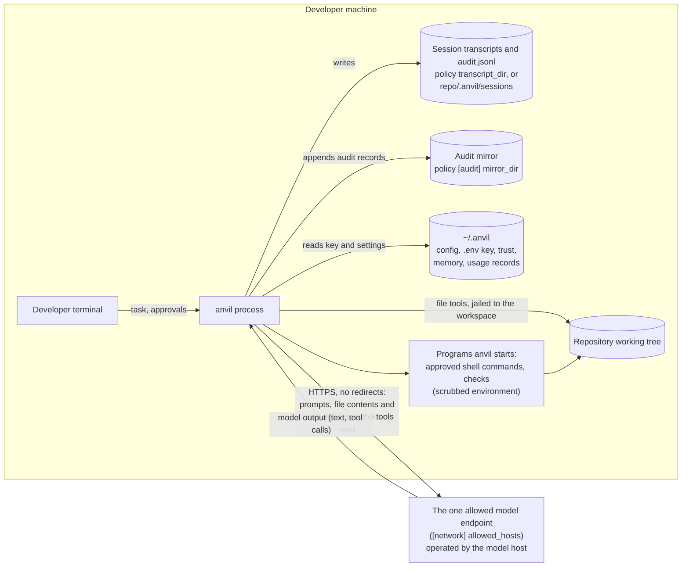

# Data flow

What leaves the developer's machine when anvil runs, and where it goes. Under a managed policy (`policies/restricted.toml`) the picture below is the whole of it.

## What goes to the endpoint

Each model request carries the system prompt (anvil's own instructions, the user's `~/.anvil/ANVIL.md`, and a trusted repository's instruction files), the task, and the conversation so far: the model's earlier answers, the arguments of its tool calls, and what each tool returned. That includes the contents of files the tools read and the output of commands that ran. The API key goes in the request header. Nothing is sent before the request's URL passes the egress check in `crates/anvil-core/src/net.rs`, which runs on every request, and the key is attached only to a request to the endpoint's own `host:port`.

## What anvil contacts besides the endpoint

Under a managed policy: nothing. The other destinations in SECURITY.md are each off by default under a policy:

- MCP servers and hooks, which a policy allows only by name: a local server by its program, an HTTP server by its URL, whose `host:port` must also be in `[network] allowed_hosts`;
- the proxy, when the policy's `[network] proxy` names one or is `system` (the default is none);
- the model list during `anvil setup --endpoint`, which goes to the same allowed endpoint.

anvil sends no usage data anywhere and has no update check, analytics, web search or web fetch. HTTP clients can only be built in `net.rs`, which a test and a lint enforce. `anvil doctor --egress` lists every destination the installed configuration can reach.

## What anvil does not control

- **The model host** receives everything listed above. How long it keeps prompts, who can read them, and how the server is secured are the host's responsibility.
- **Approved shell commands** run with the developer's rights in `ask` mode on the host. `curl`, `wget`, `ssh`, `git push` and package installs are refused by the built-in deny categories, but a build script that downloads dependencies, or a command hidden from that text match, can still reach the network. `[shell] mode = "allowlist"` starts only listed programs without a shell, and `executor = "container"` runs commands with no network at all; otherwise add an operating-system sandbox or network control around anvil where that matters.
- **Transcripts** contain everything the session read, after redaction, in plain files (owner-only on Unix). Choose how much they keep with `[data] transcript` (`full`, `metadata`, `off`), place them with `transcript_dir`, keep them only as long as needed with `retention_days`, and protect the folder like source code.
