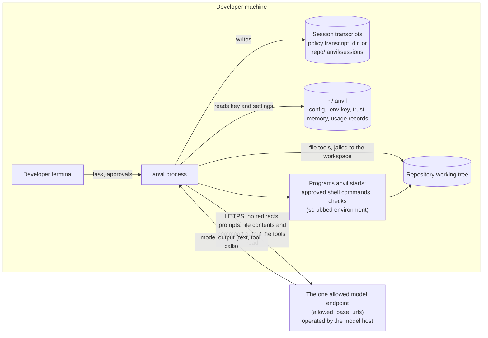

# Data flow

What leaves the developer's machine when anvil runs, and where it goes. Under a managed policy (`docs/enterprise/policy.example.toml`) the picture below is the whole of it.

## What goes to the endpoint

Each model request carries the system prompt (anvil's own instructions, the user's `~/.anvil/ANVIL.md`, and a trusted repository's instruction files), the task, and the conversation so far: the model's earlier answers, the arguments of its tool calls, and what each tool returned. That includes the contents of files the tools read and the output of commands that ran. The API key goes in the request header. Nothing is sent before the endpoint passes the egress check in `crates/anvil-core/src/net.rs`.

## What anvil contacts besides the endpoint

Under a managed policy: nothing. The other destinations in SECURITY.md are each off by default under a policy:

- the ticket queue (`[tickets] queue`), a git push the user runs explicitly;
- MCP servers and hooks, which are local programs, and which a policy allows only by name;
- the model list during `anvil setup --endpoint`, which goes to the same allowed endpoint.

anvil has no telemetry upload, update check, analytics, web search or web fetch. HTTP clients can only be built in `net.rs`, which a test and a lint enforce.

## What anvil does not control

- **The model host** receives everything listed above. How long it keeps prompts, who can read them, and how the server is secured are the host's responsibility.
- **Approved shell commands** run with the developer's rights. A command such as `curl` or a build script that downloads dependencies can reach the network directly. Limit `shell` with `shell_programs` (the strict profile does), and add an operating-system sandbox or network control around anvil where that matters.
- **Transcripts** contain everything the session read, in plain files. Place them with `transcript_dir`, keep them only as long as needed with `retention_days`, and protect the folder like source code.
